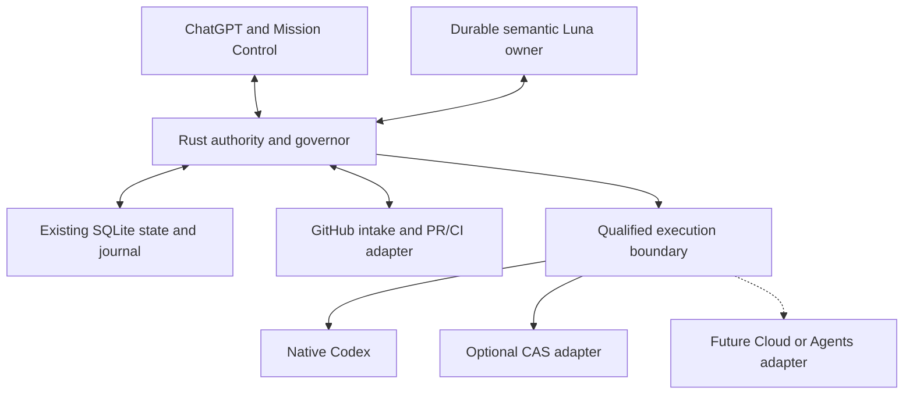
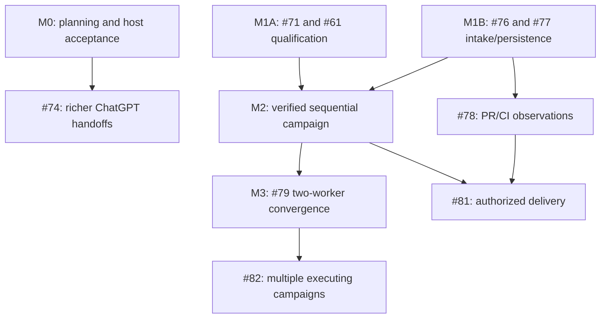

# Luna Factory — Architectural Convergence Investigation

**Research date:** 10 October 2026, UTC. **Scope:** read-only source investigation, local disposable verification, architectural decisions and an engineering handoff. This report authorizes no implementation, execution, deployment, issue mutation, merge or release.

## Executive decision

**Keep the Rust/SQLite authority. Finish qualification and objective evidence before expanding concurrency.** Luna Factory already contains a serious control kernel: immutable admission, repository claims, revision and replay fences, attempt lineage, current-subject evidence, bounded continuation, uncertain-effect reconciliation, and cancellation that refuses to equate an interrupt acknowledgment with cessation. Rebuilding these under Hive vocabulary or porting Review's reducer again would lose time and risk weakening protections. [L-control] [L-store] [L-evidence] [L-continuation] [L-lifecycle]

The meaningful additions are narrower:

- **From current Hive:** logical operation identity distinct from execution attempts; exact authority epochs around effects in enforce mode (the default is shadow); current cross-process journal/replay behavior; and, on v6, execution-owned stage settlement, durable abandonment, and workspace/process fences with real subprocess test cases. Adapt those invariants where Luna lacks them. Hive's current objective-proof packages are not a demonstrated end-to-end production convergence gate. [H-executor] [H-journal] [H-verify] [V-settlement] [V-abandon] [V-fence]
- **From Review:** preserve its separation of constrained workers, deterministic verification and semantic acceptance. Its default and PR275 core have no Factory-source delta from the R/RG donors already considered by Luna. The new PR353 delta is immutable original worker provenance plus separate verification of the actual committed head, retained PR/CI observation scheduling, source/policy-bound checks and bounded same-PR repair. PR353 is a draft with important fixture and native qualification limits. [D-native] [D-service] [P-evidence] [P-service] [P-tests]
- **Keep native to Luna:** one durable semantic owner, one deterministic authority, one lifecycle/evidence vocabulary, SQLite persistence, repository identity fencing, existing continuation, and ChatGPT's conversational surface. The workbench remains a projection. [L-adoption] [L-lifecycle] [L-store] [U-contract]

Three missing foundations determine the sequence. First, an execution qualification record must actually gate the direct effect path; today's capability/UI eligibility flag does not do that. Second, ordinary engineering success needs a captured acceptance contract and independently obtained check results, beyond hashing a file whose contents claim tests passed. Third, safe parallelism requires per-attempt ownership, settlement and candidate proof, then proof of the combined result; the present serial run-global subject and settlement cannot simply be reused unchanged. [L-lifecycle] [L-evidence] [L-control]

**Cloud Tasks should remain ineligible as an automatic writer.** The official experimental CLI can create, list, inspect and retrieve changes, but its inspected contract lacks cancellation, steering, continuation and a caller-keyed create recovery guarantee. The newer published-environment Cloud product and the separately documented beta Agents API are different surfaces. The latter is a possible explicit API-billed provider, not proof of Cloud Tasks or Plus parity. [C01] [C03] [C04] [D04] [D20] [D21]

The ordinary-user path remains subscription-first: a locally owned, qualified Codex runtime, or the eligible open-source Sign in with ChatGPT plan-usage integration, without requiring API billing. Compute, application distribution, account entitlement and unattended execution are separate gates. This research does not establish that every Plus account can install a custom write-MCP app in ChatGPT. [D02] [D07] [D08] [D18]

## How to read the evidence

Every status below has a scope. **Observed source** means the named immutable implementation was read. **Tested here** means a recorded local test/probe was actually executed. **Hosted checks observed** means GitHub reported success on an exact head; it is not deployment evidence. **Reported runtime evidence** means the user's supplied Dakota/ChatGPT observations, not a fresh probe by this investigation. **Qualified execution** requires a live contract test on an exact provider, authorization route and containment profile. **Proposal** means future engineering, not an existing capability.

The requested implementation classes are used as follows:

| Class | Meaning |
| --- | --- |
| Implemented with tests | Code and meaningful tests exist; this report separately states whether they ran here, in observed CI, or were only source-reviewed. |
| Implemented but unqualified | The path exists, but its live provider/platform/authority behavior has not been established for the target. |
| Partial | Some required lifecycle methods or production callers are missing, or the assurance is narrower than the feature name. |
| RFC-only | An accepted or proposed design without a corresponding complete implementation found. |
| Superseded | A historical defect/design no longer describes the inspected branch. |
| Obsolete for this target | A mechanism may still work elsewhere, but should not become Luna's architecture. |

The supporting Hive, Review and provider reports preserve longer traces, exact files, historical PRs and test names. Their implementation evidence has been checked against cloned immutable objects; principal conclusions were also independently inspected during synthesis. The capability matrix below summarizes those traces rather than replacing them.

## Contents

1. Current-state ledger
2. Prior-art inventory and adoption decisions
3. Convergence/governor algorithms, invariants and recovery
4. Capability-convergence matrix
5. Minimal target architecture and interfaces
6. Cloud/native/CAS feasibility and ordinary-user deployment
7. Existing issue/PR reconciliation
8. Dependency-aware engineering campaign
9. Acceptance and verification strategy
10. Operator decision memo
11. Evidence methods, limits and source families

## 1. Current-state ledger

### 1.1 The moving checkpoint changed during research

**PR #68 merged during this investigation.** GitHub reports merge time **2026-10-10 20:29:40 UTC**, merge commit **`bec70a58865a1602dba6514736ec5101ba21a48b`** and final source head **`96c84332c94e21c6ac3af1590cb805993ac2ceda`**. The 20:32:09 UTC reconciliation identified that merge; a 20:50:45 UTC remote/issue refresh reconfirmed `main`, tree `090d71704650f91cdd0e9cf7dedb9bff8ec5aceb`. A final `git ls-remote` at 21:04:39 UTC reconfirmed the same main commit. It is no longer an open draft. [PR68]

| Evidence track | Exact observation | What it establishes |
| --- | --- | --- |
| Prior merged baseline | PR66 merge `dd304ef7a9ff8835176963ab26b72a72c1528607`; PR66 head `fd9b2ecc0913a34d2e2488750a67ece7bb3dec4f` | Source baseline for the Rust investigation. [PR66] |
| Current merged source | PR68 merge `bec70a58865a1602dba6514736ec5101ba21a48b` | Campaign Map/Lanes are merged source. [PR68] |
| Final UI head | `96c84332c94e21c6ac3af1590cb805993ac2ceda`, branch `luna-factory/mission-control-ui` | Replaces the user's earlier `695e550...` checkpoint. Earlier in this session `8a222015...` was also observed. |
| Rust equality | `git diff dd304ef... origin/main -- plugins/luna-factory/server` is empty | UI merge does not invalidate the inspected Rust source. |
| Research working copy | Clean local `main` at `dd304ef...`, tracking `origin/main` at `bec70a5...`, intentionally behind by one | A stable research checkout. It is not Claude's worktree; that worktree was not inspected or edited. |
| Hosted verification on final UI head | `rust`, `ui`, `validate-linux`, `validate-windows`: completed/success | Exact-head CI evidence, not just the PR body's older check summary. [CI-rust] [CI-ui] [CI-linux] [CI-windows] |
| Local isolated UI snapshot | `npm run build` passed; **171 tests passed, 1 optional test skipped** | TypeScript/bundle and local UI regressions passed on final UI source. Initial extraction-only missing-package errors were corrected by adding the original package files; final logs are retained. |
| Post-merge verification | The later unfiltered Actions query returned two successful `push` workflows on `bec70a5...` | Separate merged-commit CI is now observed. The earlier PR-only workflow wrapper returned no runs and could not establish push-run absence. [CI-main-luna] [CI-main-plugins] |
| PR68 real-server captures | Checked-in harness/doc reports six browser captures from a disposable daemon, recorded #67 graph, revision 4, 15 tasks, zero attempts/claim | Source-reviewed local harness evidence. Not freshly rerun here, and not authenticated ChatGPT. [U-live] [U-contract] |
| Deployed isolated Dakota preview | User reports PR66 head `fd9b2ecc...`, independent Cutover to `127.0.0.1:18789/mcp`, 22 MCP tools, preserved planning canary | Reported deployment/host evidence only. This investigation made no live service/tunnel call. |
| Authenticated host acceptance | User reports successful read-only graph/canary calls on that older preview | Does not establish that PR68 is deployed or accepted in ChatGPT. |
| Execution | User reports zero active workers, no pending decision, no held canary claim, no authorized execution; native unqualified; CAS/cloud disabled | Preserve planning-only state. No execution qualification was attempted. |

The research environment lacks `cargo`, `rustc` and `go`. No local Rust/Hive build is claimed. Rust hosted checks were observed separately. The local UI test result is newer and slightly different from the PR body's “169 passed” count; the final log is the evidence for this investigation.

### 1.2 Milestone provenance

| PR | Merge commit | Reconciled role |
| --- | --- | --- |
| [#60][PR60] | `4b964042355306ea353a740bb3485a120f4892f7` | Native Rust/workbench foundation. |
| [#62][PR62] | `448d0106892d843afe8cf4f0f84d3d5aea6e7c0d` | LF01–06, including repository-bound planning. |
| [#63][PR63] | `ba58a8344ef94bd11521079f2c0ac2b7347afb3c` | Bounded continuation of admitted work already landed. |
| [#64][PR64] | `04148d429e9a8ba598697d2e9c0b6d37ee94c15d` | Bounded CAS inspection/reconciliation, not CAS execution authority. |
| [#65][PR65] | `ebe2753ed032347456ef9b1c193646469bf17c96` | Daemon transport repair and v0.2.1 release; distinguish release bytes from later source sharing a package version. |
| [#66][PR66] | `dd304ef7a9ff8835176963ab26b72a72c1528607` | OCI/ChatGPT extensions and dogfood fixes; inspected Rust baseline. |
| [#68][PR68] | `bec70a58865a1602dba6514736ec5101ba21a48b` | Mission Control UI merged during research. |

### 1.3 Owner boundaries and current issue graph

GitHub returned exactly fourteen children, #69–#82, under #67. All were open and unassigned in the inspected snapshot. Claude's UI ownership comes from the user's explicit assignment and PR68 authorship; there is no evidence of named backend assignees. Proposed roles in the handoff are assignments to make later, not workers already authorized. [I67] [PR68]

#61's updated body explicitly credits merged PR63 and distinguishes implemented fixture gates from outstanding authenticated owner/worker, subscription and cessation evidence. It should not be treated as an unimplemented continuation pump. The separately protected historical blocked claim remains outside this investigation. [I61]

Dependencies in issue bodies are not necessarily native GitHub dependency records. For example, `GET /issues/79/dependencies/blocked_by` returned an empty list even though #79's body requires #71, #77 and #61. PR68's recorded graph fixture deliberately restricts imported `Requires` edges to #69–#82, so it omits external #61. That fixture is useful rendering evidence, not a complete executable engineering graph. [I79] [U-fixture]

## 2. Prior-art inventory and adoption decisions

### 2.1 Hive and Hive Commons provenance

The canonical runtime is **`hivecommons/hive`**. GitHub identifies `joshyorko/hive` as its fork, with upstream parent/source pointing there. Hive Commons is the umbrella organization; its own sibling-repository inventory identifies Hive as the governor/manager/dashboard/hub/relay release and `docs`/`.github` as supporting sources. Do not invent a second “Hive Commons runtime.” Historical `kubestellar/hive` links belong to this lineage. [P-upstream-api] [P-fork-api] [P-org-profile] [P-repositories]

| Source | Immutable revision | Classification and use |
| --- | --- | --- |
| Canonical default v5 | `38195751be0966d59163280e765352f4e479f0fd` | Current default source, deeply inspected. |
| Canonical edge v6 | `5779820b1dc0edbd8ede2556e3e6b6c610a54fbe` | Separate implemented executor/lease changes; do not call them default-v5 behavior. |
| Upstream frozen v4 | `7cc83557ef0c64630e4265d7cdaee15294ef9b77` | Historical branch, not the current implementation baseline. |
| Josh fork default v4 | `f395d4ce48c0a16369167d3ed9cd6ed5331f0dca` | Provenance; a default-only fork inspection would miss current upstream. |
| Josh factory-execution research | `05c82fe4b35667c886987edee44224c062338710` | September audit/implementation handoff; historical upstream baseline `e0e99f7b2d37f1344fcc8b001f59b0133ab660f6`. |

All Go files under `src/pkg/convergence` match between inspected v5 and v6. New v6 execution ownership lives in dashboard/stage-lease/planengine files, which is why package-name-only research would miss it. [V-observer] [V-executor] [V-settlement]

### 2.2 Review and the donor loop

Review's default is `self-hosted` at **`4305efce0c156dc4224dd95db8e493be5f1abee5`**. The Factory subtree/tests are unchanged from donor R, `6b18ff1c35df4eb144a61add9c69271484195c02`. PR275's current head `7aeaf024c9e7fbc35967afcf18738fc0cf973900` likewise adds no Factory code/test delta over RG, `144c0a7f4fee4c4306a3e8d02b4c610ecb70877a`. Luna's adoption document already records R/RG decisions. This does not mean every OMP execution adapter was ported; it means another reducer/batch-pump port is unjustified. [L-adoption] [D-index] [D-service] [RG-service]

Review PR353 at **`51094b041c975ac258bb2339d211fafb33e84776`** is the important incremental draft. PR355 at `1150839faaf1a5170e60c529d55a63fa0962600b` is a policy-hook qualification probe, not a production spend governor. The historical `factory/hermes-supervisor-contract` branch at `3fe6825ac6247ae991e59847a6509855f5c28f5f` contributes a design document, not another functioning supervisor. [P-model] [P-service] [Q-policy] [H-supervisor]

Review's current instructions separate OMP native execution from Factory control. The two implemented paths also differ: the conversational `task` wrapper uses native OMP routing and leaves job cancellation to OMP; selected batches run constrained SDK sessions, prohibit agent descendants, use separate verification/acceptance, and await abort/disposal. Their guarantees cannot be pooled into a fictional universal executor. [D-agentic] [D-index] [D-native] [D-capabilities]

### 2.3 Changeplane: recover the lessons, leave the engine

Two historical unmerged drafts were inspected directly:

| Source | Pin and disposition | Useful result |
| --- | --- | --- |
| PR45, `changeplane/language` | `2bec221f0158ac8ef21a31324b2547b034d4dc4e`; closed unmerged | Rich validation vocabulary for subjects, grants, fingerprints, checkpoints and draining. A language/conformance validator, not a deployed factory. [CP45] [CP-language] |
| PR47, `experiment/changeplane-fast-reference` | `6e0d19f1298a1f8b7963bd3cea8989e8274bc9e6`; closed unmerged | Small prototype with weaker guarantees than current Luna. [CP47] [CP-engine] |
| Issue46 learning record | Closed as not planned | Human attention budgets, delta-first reporting, diagnosis before repeated repair, retained failed attempts, and separation of planning from execution. [I46] |
| Later issue59 / Luna adoption | Current independent-runtime direction | Salvage the invariants; do not revive the whole Changeplane ontology/runtime. [I59] [L-adoption] |

Local original test results: **34 language tests passed; 16 prototype tests passed.** Additional pure-function probes against the unchanged historical prototype showed four limits: a self-cycle raises `RecursionError`; same-key/different-payload lookup returns the prior receipt instead of a fingerprint conflict; scheduling tolerates missing proof; and an empty reconciliation can mark quiescence satisfied despite invalid checkpoint/drain. These are reproducible, retained observations, not claims inferred from RFC text. [CP-engine] [CP-reconcile]

**Retain** the human-facing and diagnostic lessons. **Reject** the weaker scheduler, recursive evaluator, replay semantics and broad ontology. Current Luna has bounded cycle rejection, fingerprint conflicts, explicit settlement and generation-bound evidence already. [L-control-tests] [L-graph-tests] [L-admission-tests]

### 2.4 Inventory of the mechanisms that matter

| Mechanism | Actual source/classification | Decision for Luna |
| --- | --- | --- |
| One neutral readiness decision shared by queue and dispatch | Hive v5 production path plus source-reviewed regression tests; partial-ledger unmanaged admission is a deliberate compatibility rule. [H-admission] [H-deps-tests] | **Retain existing / adapt** completeness and source-aware unknowns; reject “no declaration means admit” inside an enrolled campaign. |
| Exact outcome/subject/policy/producer evidence and selective assumptions | Hive proof packages implemented with tests; production `VerifyCurrent`/`AdmissionDependency` callers not found. [H-verify] [H-assumptions] [H-invalidate] | **Adapt** missing predicate/producer/policy bindings into Luna's actual acceptance gate; do not import another proof store. |
| Logical effect identity, epoch fences, unknown result and typed replay | Hive mutation boundary actually wired; current journal cross-process fixes supersede September gaps. [H-executor] [H-journal-cross] [H-replay] | **Adapt** to future GitHub/integration effects; retain Luna's stronger required-store startup and existing native intent fencing. |
| Durable stage settlement by executor | Hive v6 implemented with production-loop/restart tests; not all cost/failed-save windows settled. [V-settlement] [V-budget-test] | **Adapt** charge-before-retry and one settlement owner; retain original campaign ceilings. |
| Durable abandonment and non-resurrection | Hive v6 implemented with rollback/restart tests. [V-abandon] [V-abandon-tests] | **Adapt** a terminal authority fence when campaign cancellation is added; do not confuse it with stopped processes. |
| Inherited workspace fence and process-group cleanup | Hive v6 Unix code plus real subprocess tests; not run here. [V-fence] [V-pgroup-tests] | **Adapt** only to an owned process scope; qualify native shared-daemon and other platforms separately. |
| Restricted tools, captured checks, independent acceptance | Review selected SDK path implemented; local sandbox gate did not pass here. [D-native] [D-service] | **Adapt** the verifier and isolation contract to native Codex; avoid OMP dependency. |
| Immutable original plus current committed proof | Review PR353 draft implementation; local core/fixture tests pass with documented fixture bypasses. [P-evidence] [P-tests] | **Adapt** the invariant; multi-worker aggregate proof is new engineering, not already in PR353. |
| Retained hosted-check schedule and same-PR repair | Review PR353 implementation and controlled fixtures, native/live qualification absent. [P-service] [P-github] | **Adapt** under #78/#81 after the effect gate; keep telemetry read-only until separately authorized. |
| Advisor escalation | Review default has one bounded request per worker attempt, exact binding and cleanup. [D-native] | **Adapt** contract under #80, not OMP's Advisor machinery. |
| External-work binding/incarnation and receipt intake | Hive Dispatch has production wiring; Recover/Decide/Cancel remain package/conformance paths. Flue conformance uses an in-tree fake process and smoke uses a fake HTTP engine, not vendor qualification. [H-extwork] [H-ext-wire] [H-flue-fixture] [H-flue-smoke] | **Adapt** provider identities and tests; **defer** qualification claims until actual lifecycle callers exist. |
| General cost governor / anti-self-certification IAM / remote campaign fabric | Narrow kick limits implemented; generalized authority and complete spend/descendant governance not established. [H-governor] [I-4257] [Q-policy] | **Reject** blanket assurance; **adopt** only narrowly enforced controls and explicit acceptance roles. |

## 3. Convergence and governor: algorithms, invariants and recovery

Each mechanism below identifies the correctness problem, actual enforcement path, protected invariant, persisted state, crash/retry behavior, admission/stop behavior, evidence rules, existing equivalence and smallest justified adaptation. Semantic judgment remains with the Luna owner; deterministic checks remain in Rust or a qualified provider boundary.

### M1. Repository identity and bounded mutation authority

**Problem and invariant.** An alias, cwd or repository URL must not silently rebind an admitted run to different mutable resources. At most one admitted Luna mutation owner may hold the current repository claim. Current local identity is derived from the canonical Git common directory, not the GitHub numeric repository ID. Worktrees sharing that common directory share the claim; separate clones can have different local identities. The graph also binds a physical repository stamp. [L-store] [L-repositories] [L-graph]

**Actual path and persistence.** `start_factory` → `Factory::start` → `Store::admit`; planning uses `create_factory_graph` → `admit_planning`. SQLite admission uses an immediate transaction, unique idempotency key/fingerprint, immutable request/root/base/deadline and a unique repository claim. Execution additionally rechecks alias/profile/finish authority, repository stamp, source and skill before native packets. Graph proposal/application fence source and revision. [L-http] [L-lifecycle] [L-store]

**Recovery/admission/stop.** A changed alias, replacement Git directory, stale writer or unknown claim refuses further effects. Planning creates no worker/claim and cannot be converted by changing a flag. Claim release requires the recorded owner, eligible control state, stopped settlement and no unknown effect; convergence additionally needs current proof. Restart preserves uncertainty rather than claiming a vanished process stopped. Tests exercise duplicate starts, privilege expansion, alias remap, inode replacement and interrupted ownership. [L-admission-tests] [L-graph-tests] [L-decision-tests]

**Comparison and decision.** Hive's repo/task claims and Review's host-wide claims solve related problems, but neither should become another authority. **Retain** current physical identity/claims. **Adapt** a separate forge identity and explicit forge→execution binding under #76/#77, then task workspaces under #79. A remote issue graph can be inspectable before a local checkout exists without pretending that forge identity grants a writer lease.

### M2. Readiness is an authority decision, not a picture of dependencies

**Problem/invariant.** Only necessary, authorized work with current prerequisite evidence may become executable. `admit_task` checks known acceptance bindings, declared necessity, exact subject/assumptions, an owned claim, allowed effects, bounded dependency traversal, cycles/missing predecessors, current prerequisite proof, repair bounds and unknown effects. `Candidate` becomes READY only after admission. A rejected candidate is retained as Blocked with a reason. Observed native children remain unverified candidates, not automatically admitted tasks. [L-control]

**Persistence and recovery.** Tasks, assumptions, prerequisite references, selected task and rejection reasons are in Control and journaled snapshots. Graph edits have expected revision, canonical fingerprints and replay behavior. Source/dependency/assumption changes invalidate current proof and are checked again on dispatch; a completed task label alone does not satisfy a prerequisite. [L-store] [L-graph] [L-evidence]

**Hive comparison.** Hive shares one neutral readiness result between the queue and actual selection, with True/False/Unknown and source-local degradation. Its actual partial-ledger compatibility policy can admit undeclared work; legacy done/closed dependencies are explicitly a weaker concept than objective truth. The fan-out helper has prior-wave and overlap tests, but main supplies a one-wave snapshot without the optional overlap index. Therefore neither helper tests nor the dashboard's “ready” label prove the whole runtime barrier. [H-admission] [H-deps] [H-fanout] [H-fanout-wire]

**Smallest adaptation.** **Retain** Luna's explicit enrolled frontier and current proof. Make every scheduler and UI action descriptor consume the same authoritative decision. Add source-completeness facts for GitHub intake. Derived “prerequisites met” in the Campaign Map stays labeled as a visualization, never a dispatch permit. Atomic reservation of a selected set can admit a safe subset explicitly; it need not stall independent tasks behind a broken source elsewhere. [U-map] [L-graph-tests]

### M3. Current evidence and semantic acceptance

**Problem/invariant.** A worker's success story, successful exit, sibling receipt or obsolete artifact cannot certify the current objective. Luna binds evidence to task, attempt, intent generation, dispatch generation, source subject and assumptions. `binding_identity_current` requires the latest same-task returned/stopped attempt and stopped run settlement. Criteria need current passed check references plus separate semantic acceptance; tasks also need their own scoped references. Dependencies are recursively current with bounded cycle protection. [L-evidence]

**Actual path.** Native events record bounded observed command facts; exit zero is unverified when complete output/environment cannot be proved. On a settled owner return, `finish_turn_locked` reads the native report, re-observes source, reconciles file checks and acceptance, checks candidates/selection, revalidates repository/skill/current files and only then settles. File checking opens bounded regular relative files without symlink traversal and hashes actual bytes. Source/assumption changes and new dispatch invalidate old acceptance. [L-lifecycle] [L-evidence] [L-evidence-tests]

**Important scope.** This is already real evidence enforcement for its supported file-fact contract. It is not independent proof that a prescribed engineering test suite ran in the right environment: hashing a report file validates the file, not the report's assertions. The semantic owner must still decide whether the facts satisfy the agreed objective. [L-evidence] [L-control]

**Donors/adaptation.** Review's constrained verifier captures checks before worker changes, executes them independently, retains complete artifacts and runs a fresh acceptance session. PR353 adds current committed-head verification without relabeling the worker's original receipt. Hive adds exact predicate/policy/producer and declared-assumption fingerprints, but its full objective gate remains incompletely wired. **Adapt** a versioned predicate specification, trustworthy checker result and separate current-candidate acceptance. Keep historical receipts immutable and only invalidate current applicability. A different model name alone does not establish independent authority. [D-native] [D-service] [P-evidence] [P-service] [H-proof] [I-4257]

### M4. Dispatch, logical operations and lost acknowledgments

**Problem/invariant.** A retry after a timeout must not launch duplicate work or repeat a push/PR effect that already happened. Luna persists `EffectIntent` and dispatch identity before native calls. Dispatch generation increases by one, with no second active or intent-unknown attempt. A persisted UUID is also sent as `clientUserMessageId`; native history can correlate it. The native field is an echo/correlation contract, not a server-side idempotency guarantee. [L-control] [L-lifecycle] [L-native] [N15]

**Recovery.** Reconciliation uses stored handles and bounded passive reads. It never repeats an uncertain native start merely because a transport closed. Same event/key with the same fingerprint replays; different payload conflicts. CAS independently demonstrates useful at-most-once dispatch-attempt suppression with its durable keyed receipt; local probes passed replay, conflict and before/after-ack crash cases. Its unknown window stays unknown. [L-store] [L-continuation-tests] [A02] [A03]

**Hive's incremental value.** The logical ID for an external mutation includes the desired effect's load-bearing inputs but excludes a particular worker/epoch/attempt. In enforce mode, the executor refuses stale authority before the effect and again before accepting its acknowledgment; both enabled modes journal intent and results. Only an explicit no-effect refusal permits retry without reconciliation; a generic error remains unknown until authoritative reconciliation establishes its outcome. Applied replay rehydrates the original result. Current journal flock/reload fixes supersede the older in-process-only defect. [H-journal] [H-executor] [H-journal-cross] [H-replay]

**Enforcement-mode qualification.** Hive currently defaults to `shadow`; an invalid nonempty mode becomes `off`. Epoch/claim refusal is enforce-mode behavior. Generic mutation shadow mode can execute the real effect while recording diagnostics; external-work shadow dispatch instead persists a result without starting external work. Contributor dependency admission is a separate, always-active gate. These modes cannot be pooled into a claim that every default Hive effect has hard fencing. Luna should retain mandatory authority checks on its admitted effect path. [H-config] [H-convergence] [H-executor] [H-ext-admission] [H-deps]

**Smallest adaptation.** **Retain** native intent fencing. Extend the existing effect model for #81 with typed original results and stable logical operation identity. A negative remote lookup proves safe retry only if the remote contract excludes a delayed prior effect; “not found yet” is not sufficient. Do not import Hive's synthetic `repo@mutation`, generation 1 or fail-open boundary initialization. [H-boundary] [H-main-boundary]

### M5. Bounded continuation already exists

**Problem/invariant.** Useful admitted work should continue without repeated human prompts, while preserving scope, budgets, identity and stop barriers. PR63's `continuation::decide` accepts an explicit live-owner `next` or `repair` directive. It requires QUIESCENT control plus independently stopped owner/children, current source/claim, no live or unknown attempt/effect, admitted selected work and remaining original deadline/budgets. A fresh necessary READY task does not consume a repair. Same-task repair requires current observed failure references and bounded diagnosis. [L-continuation] [L-continuation-policy-tests]

**Call path.** Only `finish_turn_locked` with `FinishOrigin::LiveOwnerEvent` can trigger the automatic continuation path. It persists the settled turn first, then re-enters guarded dispatch on the same durable owner with new attempt lineage. Replayed terminal reports and startup recovery do not execute their saved directives. [L-lifecycle]

**Proof.** Tests include two tasks continuing without an external resume, same-task repair retaining deadline/budget, independent ready work proceeding despite unrelated blocked dependencies, a real decision stopping automation, stale source/unknown child/effect refusing continuation, lost-ack recovery and startup refusing replay. These drive the production Factory with a fake native transport; they do not prove subscription routing or real native descendants. [L-continuation-tests]

**Decision.** **Retain existing**, reconcile #61 as implemented behavior with remaining live qualification gates under #71. Do not build another pump. If later restart-autonomy is required, add a one-use persisted continuation authorization tied to the settled attempt and unchanged admitted next task/policy/budget. That is future work, not an assertion that current startup autonomously resumes useful work. [I61] [PR63]

### M6. Governor budgets, reservations and safe fan-out

**Existing enforcement.** Luna validates maximum threads, repair allowance and wall time, preserves an absolute deadline, checks capacity after native observation, watches the deadline independently of the event stream and deduplicates child-failure charges by identity. Candidate/retry admission is deterministic. However, child policy is explicitly `cooperative_unverified`; post-spawn capacity/model mismatch cancellation is not a pre-spawn permission gate. No authoritative per-campaign token/dollar reservation ledger exists. [L-config] [L-control] [L-lifecycle] [L-regression-tests]

**Hive/Review comparison.** Hive's token/coin/USD governor suppresses future kicks using persisted usage baselines, not transactional campaign reservations or immediate cessation of active descendants. Review counts turns and bounds attempts; it does not implement a hard provider/account spend governor. Hive v6 improves generation settlement: the observer has no retry authority, the executor settles spent generations, retry/escalation state persists, and the integrated test drives the real cleanup/keepalive order. Failed settlement bookkeeping still has an in-memory crash window; infrastructure retries do not necessarily spend semantic repair budget. [H-governor] [D-native] [Q-policy] [V-observer] [V-settlement] [V-budget-test]

**Smallest adaptation.** **Adapt** one persisted reservation/settlement path in Rust. Reserve before dispatch; charge active owner turns, workers, model verifiers and escalation consistently. Unknown/cancelling reservations remain occupied. Keep separate ceilings for attempts, semantic repairs, escalation, elapsed time and observed usage; no counter should reset through a new process or model. Hard token/cost claims require authoritative, sufficiently timely accounting or provider-enforced reservation. Delayed counters and estimates are advisory; subscription tokens must not be priced as an API invoice.

### M7. Crash recovery, cancellation and verified cessation

**Existing path.** Store snapshots and event fingerprints are verified; corrupt state fails closed. The daemon holds one writer lease plus a mutation mutex. Recovery preserves owner identity/claims/deadlines, reconnects only through supported ownership, passively observes and correlates known work, and does not infer absence from truncated pagination or missing threads. On cancel, Rust persists CANCELLING before interrupts, repeatedly enumerates descendants, stops owned terminals with fresh process identity and records stopped only after all required observations agree. Lost acknowledgment, unknown child state or a disappearing terminal is not a release proof. [L-store] [L-lifecycle] [L-native] [L-decision-tests] [L-native-tests]

**State distinction.** QUIESCENT means no useful admitted next step is available; it does not by itself establish physical cessation. `Settlement`, owner/child liveness and unknown effects are separate. A stop request also does not prove cancellation completed. The public projection must combine the same authoritative facts. [L-adoption] [L-control] [L-lifecycle]

**Hive v6's useful increment.** Abandonment durably removes stage leases and writes a non-expiring tombstone atomically; stale generations and failed persistence refuse/roll back. A later executor sweep initiates physical cancellation. Its Unix executor holds a workspace flock outside the worktree, verifies the inode, passes the descriptor to its child, kills an owned process group and waits before workspace cleanup. The wait joins tracked workers and pollers; `Stop` can time out after twenty seconds and returns no all-descendants-stopped receipt. These are concrete crash/cleanup invariants with tested Unix subprocess cases, not a universal cessation guarantee. [V-abandon] [V-abandon-tests] [V-fence] [V-executor] [V-lifecycle-tests] [V-pgroup-tests]

**Adaptation.** Keep Luna's stronger explicit unknown/claim-release rules. Adapt process fencing only where a worker has a separately owned process/container scope. A thread in a shared native daemon is not its own process group; killing the daemon can kill the owner and peers. Keep the workspace fence separate from the daemon singleton lease so recovery can reopen the authority while an orphan still blocks workspace reuse. [A09] [V-fence]

### M8. Failure, stagnation and deadlock

**Existing behavior.** Luna records failed attempts, computes certification progress, requires diagnosis after repeated no-progress attempts and allows one same-goal replan while retaining original ceilings. A fresh log line, successful native exit or an unverified failure claim cannot replenish repair authority. [L-control] [L-continuation] [L-evidence]

**Prior art.** Hive v5's stall detector uses child metadata inactivity, with a persisted replan count charged before its kick. It can be useful operationally, but any child update that refreshes the bead's `UpdatedAt` can count as progress without semantic improvement; all children terminal suppresses a stall without objective certification. No complete campaign-level resource/dependency deadlock proof or semantic plateau oracle was established in the reviewed donor paths. [H-stall] [H-replan]

**Smallest adaptation.** **Retain** diagnosis and repair bounds; distinguish last observation, last worker heartbeat and last accepted-evidence progress. The owner reasons about a plateau, while Rust enforces that retries/replans cannot exceed the retained budget. For the first parallel design, reject dependency cycles and reserve all needed resources transactionally without hold-and-wait. This prevents the main avoidable deadlocks without a general deadlock service. If later dynamic resource waits need cycle detection, report the actual wait-for cycle and intervention; a timer must not force-release an uncertain claim. Legitimate CI/dependency waits use bounded persisted polling/deadlines without model heartbeats.

### M9. Models, provider boundaries and approvals

**Current protection and gap.** Native preflight validates exact Luna model/catalog and effort; configured route is never presented as observed execution. Turn-bound mismatch observations cause stop behavior. Capabilities report native execution ineligible. But `Factory::start` still reaches `Store::admit` and launch without consulting a persisted qualification record. Existing operator-configured direct-native behavior and UI descriptors were deliberately separate; #71 must reconcile them before declaring the product qualified. This is a source-level admission gap, not evidence that the planning preview executed. [L-lifecycle] [L-native] [L-backends] [L-native-tests]

**Provider enforcement.** Codex's pre-tool hook can block a successfully matched call, but errors/invalid output can leave it nonblocking. SubagentStart is context injection. V2 configuration takes precedence over `agents.enabled=false`, ignores maximum depth in a checked test and has root-inclusive residency limits. These cannot be described as a proven no-unregistered-agent profile on the installed runtime. [N01] [N02] [N03] [N04] [N07]

**Target.** Rust enforces an allowed, currently qualified route before an effect; adapters enforce the selected sandbox/model/tool profile and report exact observations; the owner chooses among allowed routes and requests bounded escalation. Approval binds an operation/scope/revision, not a general permission to exceed authority. Observation and authorized stop attempts remain available when new execution is disallowed; stale qualification must not trap an operator by hiding recovery. Respect adapter deny rules rather than bypassing them with raw RPCs. Sol/Astra treatments in the UI require actual qualified observed routing. [I71] [I80]

### M10. PR/CI integration and current candidate convergence

**Current Luna limit.** Native command observation can flag push/PR effects as unknown, but this is observation rather than comprehensive pre-action mediation. The reducer explicitly refuses to settle push/PR delivery as certified. `local_candidate` can converge under the existing proof contract; a successful `git push`, `gh pr create` or merged PR alone cannot supply that proof. [L-evidence] [L-control] [L-lifecycle]

**Review increment.** PR353 retains an owned PR identity, target/head/base/operation, next poll time, original deadline and deduplicated repair identity. Its observer yields worker capacity while waiting, applies bounded backoff/Retry-After, rechecks control after awaits and policy before persistence. Required-check evidence binds rule policy, check producer/app/context and the eligible head/merge subject. Failure diagnostics have aggregate request/byte/decompression budgets; infrastructure uncertainty does not automatically spend code-repair attempts. Repair re-verifies the actual commit and persists proof/intent before a same-branch push. Read-only reconciliation never creates a new PR. [P-service] [P-github]

**Qualification/adaptation.** These are valuable algorithms with fixture tests, not a qualified native live-PR loop: the main repair fixture overrides `validateProof`. Adopt read-only observations under #78 first; add independently evaluated predicates separately; put writes and effect reconciliation under #81 after explicit authority. A sequential integration path does not logically require #79 parallelism; removing that current dependency is a proposed issue correction. For parallel work, the combined subject must bind member attempt receipts, bases and assembly operation. PR353's single latest integrated item does not already implement that aggregate algorithm. [P-tests] [I78] [I81]

## 4. Capability-convergence matrix

Hive Commons is the canonical organization, not a separate convergence engine. The first two columns compare its actual v5 and v6 runtime lines; supporting Hive Commons repositories were used to establish provenance. **I/T** means implementation and tests are present, with execution status in the ledger/appendices. **P** means partial, **Q?** means target/live qualification absent, and **D** means design-only. These are not deployment badges.

| Capability | Hive Commons / Hive v5 | Hive Commons / Hive v6 delta | Review / OMP | Current Luna Factory | Recommended target |
| --- | --- | --- | --- | --- | --- |
| State-machine authority | I/T neutral admission plus leases and separate mutation/outcome stores. [H-admission] | Executor/observer responsibilities tightened. [V-observer] | I/T reducer plus distinct conversational/batch stores. [D-reducer] | I/T one Rust Control + SQLite. [L-control] [L-store] | **Retain** one authority. |
| Objective convergence lifecycle | P exact proof packages; full current-proof gate not called in production. [H-verify] | Same proof packages; stronger stage execution does not add whole-objective certification. | R/RG I/T proof-driven finite work; P draft committed-head proof. [D-convergence] [P-evidence] | I/T current file facts + semantic acceptance; local-candidate scope. [L-evidence] | **Adapt** independent predicates and current integration proof. |
| Governor and budgets | I/T kick gates and usage baselines, not tree-wide reservations. [H-governor] | Durable stage retry/escalation, narrower than total spend. [V-settlement] | Attempts/advisor bounds; hard spend probe D. [D-native] [Q-policy] | Time/repair/capacity checks; child admission Q?. [L-config] | **Adapt** single reservation/settlement path. |
| Readiness/admission | I/T shared queue/dispatch, legacy completion/degraded-source policy. [H-deps] | Same core | I/T explicit READY and current proof. [D-admission] | I/T bounded DAG and task-bound proof. [L-control] | **Retain**, add complete forge snapshots. |
| Scheduling/fan-out | I/T workers; helper wave/overlap guarantees exceed main wiring. [H-fanout-wire] | I/T local executor limit and joins. [V-executor] | Finite bounded SDK pump; same-repo writers serialize. [D-service] | One selected task/active attempt; owner native children unqualified. [L-control] | **Adapt** two managed workers only after per-attempt migration. |
| Concurrent task ownership | I/T repo/task algebra and epochs. [H-claim-ledger] | Stronger retirement/fences. [V-abandon] | Repository/item claims, one host writer. [D-store] | Repo claim + serial attempt authority. [L-store] | **Retain** repo fence; add workspace reservations. |
| Repository/workspace isolation | Local worktrees; count/add cap not atomic across callers. [H-worktree] | Inherited local workspace fence. [V-fence] | Restricted tools, owned fresh clones, bwrap verifier Q?. [D-native] | Exact approved repository stamp; no managed per-task worktree system. [L-store] | **Adapt** qualified isolation profile. |
| Evidence/acceptance | Exact subject/predicate/policy/producer packages; incomplete runtime enforcement. [H-proof] | Same | Independent verifier/acceptance; new current committed receipt. [P-service] | Host file hashing, exact binding, owner acceptance, no exit-zero certification. [L-evidence] | **Retain + adapt** check specifications and aggregate provenance. |
| Recovery/reconciliation | Current journal lock/reload and typed replay; some store/boot caveats. [H-journal-cross] | Durable retirement; failed-settlement crash caveat. [V-settlement] | Explicit resume/unknown effects; local owner-recovery failures. [D-store] | Fenced snapshot/journal, known-owner passive reconciliation, no blind replay. [L-store] | **Retain**, test actual crash windows. |
| Checkpoints/continuation | P re-entrant turn package; runner not wired as full loop. [H-turn-runner] | Stage lifecycle improved | I/T finite foreground pump/checkpoints. [D-service] | I/T PR63 live-owner bounded continuation; restart doesn't rerun directives. [L-continuation] | **Retain existing**, only add one-use recovery authorization if needed. |
| Cancellation/cessation | Lease revoke/cleanup and extwork stop facts; lifecycle incomplete. [H-extwork] | Tombstone + process group/join; no universal stopped receipt. [V-pgroup] | Selected abort/dispose; conversational cancellation delegated to OMP. [D-native] | Explicit owner/child/terminal observation; native live qualification absent. [L-lifecycle] | **Adapt** owned execution scope, preserve unknown. |
| Model routing/escalation | Governor/provider controls; not Luna's exact policy | No demonstrated full campaign entitlement policy | One bound Advisor call; OMP-specific. [D-native] | Exact Luna preflight; mismatch stop, no qualified escalation. [L-native] | **Adapt** #80 after qualification. |
| Native Codex | External/runtime-specific adapters, not this exact Factory provider | Same qualification distinction | OMP SDK, not Codex app-server | Implemented native adapter; isolated preview Q?. [L-native] | **Qualify first**; supported stdio vs experimental daemon profile explicit. |
| CAS | Not an equivalent native execution authority | No independent target equivalence | No equivalent required CAS dependency | Read-only bounded configuration/receipt inspection; execution disabled. [L-cas] | **Retain** boundary; #75 optional observed timeline, never proof by itself. |
| Cloud Tasks | No proven complete Factory Cloud lifecycle found | Same | Deferred remote designs | Separate ineligible catalog entries. [L-backends] | **Defer** writer; preserve operation-specific seam. |
| GitHub issue intake | Runtime worksource/beads, legacy dependency semantics. [H-deps] | More run/stage integration | Finite selected GitHub snapshots. [D-service] | Revisioned repository-bound graph; no durable live intake yet. [L-graph] | **Adapt** #76/#77 stable forge identity and snapshot import. |
| PR/CI/integration | Real GitHub/automerge seams; rollout/proof caveats. [H-main-boundary] | Same objective-proof caveat | PR353 strong read/repair algorithms, draft Q?. [P-github] | Delivery remains uncertified; #78/#81 open. [L-control] | **Adapt** observation first, authorized exact-subject effects later. |
| ChatGPT control/visuals | Hive dashboard/fleet UI, not target product | Same | OMP/TUI/extension integration | PR68 merged Campaign Map/Lanes; authenticated preview pending. [PR68] [U-contract] | **Retain** selected UI, add truthful projections. |
| Multi-campaign isolation | Broader fleet ownership; not a drop-in tenant model | Stronger local run fences | Finite batch claims; not a general campaign service | One repo writer; no campaign entity yet. [L-store] | **Defer** #82 until one campaign is proved. |

## 5. The smallest coherent target architecture

**Proposal.** Extend the existing Rust authority and its database, preserve the durable semantic Luna owner, and qualify a sequential campaign before concurrent execution. The components below are responsibilities inside this architecture; they are not a proposal for a fleet of new services. Current Luna already owns the control reducer, claims, attempts, graph revisions and effect fences described in sections 1–3. [L-control] [L-store] [L-adoption]

ChatGPT negotiates scope and presents operator decisions. The Campaign Map and Flight Recorder synchronize selection, context and observed progress. Only Rust changes canonical lifecycle state. The owner interprets objectives and evidence; adapters enforce and report provider-specific facts. GitHub reads become bound observations; write authority is a separately admitted effect.

### 5.1 Components and ownership

| Component | Owns | Must not own |
| --- | --- | --- |
| Durable semantic Luna owner | Objective interpretation; necessary task decomposition; candidate dispatch proposals; diagnosis; relevant verification selection; semantic acceptance; requests for scoped operator decisions | Authority expansion, slot accounting, release of an uncertain claim, acceptance of stale evidence |
| Existing Rust authority | Revision/idempotency fences; immutable admitted scope; task readiness; reservations; provider qualification; effect intents and acknowledgments; policy enforcement; proof binding/invalidation; cancellation and claim release | Engineering meaning inferred from exit codes or a simplistic planner |
| Existing SQLite database | Campaign references, canonical graph revisions, admitted runs/attempts, policy snapshots, qualifications, claims, effect journal, verification receipts and decisions | A duplicate copy of provider transcripts or another independently writable graph |
| Native/CAS/future adapters | Actual provider calls; normalization of observed identities, source, route, usage, progress and cessation; explicit capabilities and unknowns | Final campaign state or blanket authorization inferred from transport reachability |
| GitHub adapter | Stable forge identity, bounded issue/dependency snapshots, PR/CI observations, and eventually separately authorized effects | Treating issue closure, PR merge, or any passing check as objective proof |
| ChatGPT and workbench | Conversational scope negotiation, explicit operator actions, selection context, evidence and blocker display | Dispatch merely because a view opens; authority from a visual prerequisite overlay |

### 5.2 Minimal persistence changes

Keep the existing database and immutable Run fields. The existing `Attempt` already has task, parent, intent/dispatch generations, subject, assumptions, phase and turn identity. The following are additive records or explicit migrations of global predicates, not a replacement schema or a second journal. Add them only when a milestone needs them. [L-control] [L-store]

1. `Campaign`: stable ID, authenticated principal/workspace binding, forge repository identity, parent issue identity, reference to the canonical planning graph, current plan revision, associated executable run IDs, status derived from those records. It does not duplicate the graph. A planning run stays planning-only forever. Promotion creates a new executable run from an exact plan revision, with explicit authority and an idempotency key.
2. `RepositoryBinding`: distinguish a stable forge repository ID and issue ID from the existing local git-common-dir identity/stamp. Source-only planning needs no executable checkout. Execution binds the forge source to an approved physical checkout and immutable input. Two clones of one forge repository do not become mutually isolated campaigns merely because local inode hashes differ.
3. `PolicySnapshot`: canonical policy hash/revision; allowed provider/auth route and models; operation/finish ceilings; repository/workspace scope; separate maximum worker reservations and total active model calls; original deadline and repair/attempt/escalation ceilings; accounting capability and applicable hard limits. Policy tightening invalidates admission eligibility; it cannot silently increase an active run's authority.
4. `QualificationRecord`: exact adapter and native version, transport/ownership mode, account/workspace authorization reference, sandbox/profile identity, callback mode, effective-model observation capability, descendant/process observation capability, tested operations, evidence reference, freshness/revocation state. This stores references, not credentials. Dispatch, continuation, resume and integration recheck it. An explicitly authorized qualification-only canary uses a bounded, retained grant for its named test operations; it cannot set ordinary campaign eligibility or bypass the effect/claim controls. Provider-operation qualification and end-to-end campaign acceptance are separate records. A model catalog or an existing binary is insufficient. A persistent client must own required callbacks, the workflow must be proved not to need unsupported callbacks, or it must block explicitly. CAS's bounded action connection does not provide a general durable approval/tool callback broker.
5. Extend `Attempt` for #79 while retaining its existing intent generation, dispatch generation, source subject, assumptions, phase and turn ID. Genuinely missing records include the owned worker/provider handle, workspace, policy/qualification binding, reservation, dependency evidence digest, candidate result subject and per-attempt cessation. Explicitly replace the current run-global proof prerequisites: `binding_identity_current` requires global `Settlement::Stopped`, subject and assumptions. A stopped worker's candidate cannot be certified while another runs using that same predicate. Introduce per-attempt candidate-proof validation and a separate final integration/cessation barrier before permitting parallelism.
6. Extend effect records: request fingerprint, idempotency key, intent sequence, provider handle if known, outcome (`not_sent`, `accepted`, `rejected`, `unknown`), acknowledgment/evidence references. An unknown effect reserves its slot and mutation scope. It does not receive a new key for a blind retry.
7. `VerificationReceipt`: predicate specification/version, exact candidate subject and environment, task/attempt/generation and assumptions, checker identity, result/output completeness, semantic acceptance reference. Preserve original worker receipts; append verification of the current integration candidate separately. An aggregate verification also binds its member task/attempt receipts, original bases and assembly operation. Review PR #353 supplies immutable proof provenance for one latest integrated attempt; it does not implement multi-worker assembly. Do not copy its single current-verification slot as a general aggregate-proof representation.
8. A bounded event cursor/projection for #69/#70/#78: canonical event sequence, nullable task/attempt/agent attribution only when known, observed/received time, typed blocker and links to evidence. Keep provider transcript bodies outside Luna's truth store. Current last-20 receipt UI is not a full audit log. [L-store] [I69]

### 5.3 Admission and effect protocol

The semantic owner proposes work against `(campaign, plan_revision, task_generation)`. In an immediate SQLite transaction, Rust checks the exact revision, approved necessity, current prerequisite proofs, immutable repository/subject binding, allowed effects, fresh qualification, policy hash, original budgets, lack of overlapping reservations, and no unknown effect in the same scope. It reserves capacity and persists a unique effect intent before sending anything. A final guarded pre-wire check revalidates facts that could have changed while awaiting the provider.

Adapter results must distinguish definite no-send/rejection from accepted work and ambiguous acknowledgment loss. Only definite no-send can safely be retried without reconciliation. For native `turn/start`, preserve the existing durable dispatch UUID/clientUserMessageId correlation; the inspected native contract does not promise duplicate suppression for repeated requests carrying that ID. Luna's persisted intent/no-replay policy supplies suppression. For a `thread/start` whose acknowledgment is lost, do not invent a parent ID or adopt another thread merely because it shares a cwd. Recover only through a verified owned identity; otherwise retain an unknown reservation and require reconciliation. A uniquely owned process/container may prove cessation even without a recovered thread ID; it still does not prove which earlier effects occurred. Provider APIs need not be magically exactly-once: the safety guarantee is no duplicate effect on uncertainty.

Count `reserved + dispatching + running + cancelling + unknown` against execution capacity. Apply qualification, effective-route checks and applicable call/time/spend limits to active owner turns, managed workers, model-based verifiers and escalation turns. An idle durable owner thread need not consume an active execution slot; provider residency limits are a separate capability. A cancellation request or lease timeout is not a freed slot. Reservations are released only by a confirmed rejection/no-send or verified cessation and settled effects. Attempt, repair, and escalation budgets persist across daemon/owner restarts. Wall-clock expiry blocks further admission and requests bounded shutdown; it is not proof that a remote process stopped at the deadline.

### 5.4 Logical workers and physical execution ownership

Three alternatives are real:

- Keep native owner-managed child spawning. This minimizes change but remains unsuitable for hard per-task admission until the exact provider can enforce a fail-closed pre-spawn gate, authoritative capacity, scope, and complete child census.
- **Recommended logical target:** the same semantic owner submits bounded dispatch proposals; Rust admits and owns each worker thread through a provider adapter. Record logical ownership in Luna's ledger. Do not claim native parentage if `thread/start` has none. Workers have a qualified profile that prohibits unregistered agent execution, isolated workspaces, and no ability to bypass the approved effect/provider scope. The owner remains the same durable Luna thread. Rust schedules admitted work; it does not decide the engineering objective.
- Import Hive/OMP's scheduler or make a CAS/workbench orchestration service authoritative. Reject: duplicated lifecycle and authority, heavier deployment, and no automatic solution to evidence or subscription boundaries.

Start with one qualified owner/native turn and no unregistered agent spawning, then two independent managed workers after #79. Ordinary command subprocesses have a separate containment/cessation contract. Current Codex pre-tool hooks fail open on certain failures and public plugin submissions exclude lifecycle hooks; they cannot be the sole governor. Version-sensitive `agents.enabled`, v2 thread limits, and depth behavior must be proven in #71. No inspected profile has been qualified on the installed runtime as a complete prohibition on unregistered execution. Protect credentials and policy outside the worker's writable/readable scope where the claimed sandbox guarantee requires it; do not give it CAS/native mutation tools that bypass admission. A prompt forbidding `codex`, network calls, protected-file writes or child spawning is not an enforcement mechanism. [N01] [N02] [N04] [N07] [D15]

Workspace claims are scoped to work Luna owns. They cannot prevent an unrelated human or process from changing a checkout; source fencing must detect that change and stop admission/acceptance. Keep one campaign mutation claim per logical repository initially. Within it, use distinct task worktrees and conservative conflicting-path/resource reservations. Unknown paths or shared generated/configuration resources serialize. Do not try to solve #82 while introducing #79.

Select an execution ownership profile explicitly. Multiple native threads in a shared daemon are not separate process groups. They require proven per-thread cancellation and complete applicable descendant/terminal observation; killing that daemon can kill the semantic owner and unrelated workers. The preferred qualification candidate for managed parallel workers is separately owned stdio app-server processes or isolated containers, so each worker's containment can be tested without stopping its owner. Shared-daemon parallel mode remains optional, gated on its own proof; otherwise retain serial execution. Concurrent credential refresh, account attribution and permitted token sharing inside the same application also require qualification.

Adapt Hive v6's process-group cancellation and inherited workspace fence only for a separately owned local process scope. Keep this separate from the daemon singleton lease: recovery must be able to reopen the daemon/database while the orphaned worker still prevents workspace reassignment. State the Unix/process-group scope; escaped groups, remote workers, and Windows require separate qualification. [V-fence] [V-pgroup] [V-pgroup-tests]

### 5.5 Candidate proof and campaign convergence

Existing Luna correctly rejects prose-only completion and binds file facts to task, attempt, generation, subject and assumptions. It does not yet independently execute the full engineering acceptance contract; hashing a worker-supplied test log proves bytes, not that the prescribed tests ran.

Define a versioned acceptance contract with approved predicate specifications. The owner proposes meaningful checks; an authorized policy/operator establishes their permitted execution and relevance. A verifier executes or observes them independently of the worker's completion narrative, records the exact candidate and environment, and returns typed facts. Rust checks the evidence binding and invalidates it on subject, dependency, assumption, contract or relevant policy movement. Semantic acceptance remains the Luna owner's judgment and is separately recorded.

Parallel tasks produce candidate receipts tied to their original bases. Those are historical facts, not proof that their combination works. Construct an explicit integration candidate, detect overlap/conflicts, and verify the combined immutable subject. Follow Review's separation between original worker receipt and current committed verification. A new base, rebase, repair, dependency change or edited acceptance criterion makes the current verification stale; it does not rewrite a previous receipt.

Campaign convergence requires: all mandatory objective criteria accepted on the current integration subject; all admitted required obligations satisfied or explicitly superseded by an authorized plan revision; current prerequisite/assumption proof; no unknown effect; all owned execution ceased; authorized delivery satisfied when delivery is part of the objective. Rejected unadmitted candidates are not obligations. Required blocked tasks cannot disappear from the obligation set because they are blocked. Current Rust excludes Blocked tasks from necessary-task proof, but its only assignment of that state is CandidateRejected for a new, unadmitted ID. This is not a demonstrated current obligation bypass. Adding admitted-task blocker transitions under #70/#79 must introduce and test the distinction explicitly. [L-control] [I70] [I79]

`QUIESCENT` means no useful admitted next step is currently available; accepted success and physical cessation are separate facts. Show safely stopped only when settlement independently proves it. `BLOCKED` identifies an unmet constraint; only an actual answerable operator decision belongs in Needs you. `UNKNOWN` preserves uncertainty. `CONVERGED` is revocable as a current projection when source or assumptions move, while historical receipts remain immutable. Do not add a second terminal vocabulary in the UI.

Review PR #353 is an unmerged draft. Its same-PR fixture uses fake provider/GitHub/clock surfaces and overrides production `validateProof`; its native acceptance fixture is unrun. Local Review recovery and sandbox-preflight gates also did not pass here. Adapt the algorithms and negative cases, then test the normal Luna SQLite/Factory/adapter path without bypassing proof validation on the supported deployment profile. [P-tests] [P-acceptance]

### 5.6 Recovery, continuation and cancellation

Retain PR #63's explicit, bounded live-owner continuation. Do not rerun a saved terminal directive on restart. If later autonomous recovery is needed, persist a one-use continuation authorization bound to the settled attempt, exact next task/revision, unchanged original deadline/budgets and policy; consume it transactionally. This is an extension of #61/#79, not a new owner service or unconditional pump. [L-continuation] [L-continuation-tests]

On restart: open and verify the existing snapshot/journal; recover policy and claims; reconstruct reservations and known provider handles; use only qualified passive observations such as thread/read or a bounded snapshot; classify confirmed stopped/active/unknown; correlate pending effects; invalidate stale proof; only then allow a separately admitted action. thread/resume is not a substitute for a passive read: loading runtime state/tools/hooks stays behind the effect gate. Existing snapshot integrity and fenced event replay are retained. Do not claim a complete event-sourced rebuild that the current snapshot journal does not implement.

Persist cancellation/authority revocation first, stopping any new admission and continuation for the owned subtree. Then interrupt each known owner/worker, enumerate permitted descendant/process observations, terminate owned processes where supported, and obtain explicit stopped evidence. Repeat discovery under a bounded protocol to catch late children. Failed enumeration, vanished sessions, lost stop acknowledgments and missing terminal records retain uncertainty and claims. Adapter `cancel()` must return cessation evidence or `unknown`, never a reassuring boolean based solely on an accepted interrupt.

### 5.7 Governor enforcement boundaries

| Control | Rust | Semantic owner | Adapter | UI |
| --- | --- | --- | --- | --- |
| Models/providers | Policy allowlist and qualification gate at dispatch | Choose within policy; request bounded escalation | Enforce requested route, observe effective route or expose unknown | Show Sol/Astra only from observed qualified routing |
| Capacity/duplicates | Transactional reservations; conflict scopes; unknown counts | Propose independent tasks | Enforce no unmanaged descendants; report handles | Show pending/active/unknown honestly |
| Time/attempt/repair | Original persistent ceilings, deadline watchdog | Diagnose plateau; select repair/replan within bounds | Interrupt and verify actual stop | Explain limit and next permitted action |
| Tokens/cost | Hard limits only with authoritative timely accounting; reserve conservative bound where available | Consider estimates in choices | Report trustworthy usage/billing basis; identify delayed/partial counters | Label estimates; never price subscription tokens with API rates |
| Protected resources | Admit scoped effects; policy and claim checks | Identify needed access, request human decision | Actual filesystem/network/process enforcement | Explain actual missing permission |
| Readiness | DAG and current dependency proof; no promotion from observations alone | Necessity and decomposition | None | Derived prerequisite overlay is not an executable READY state |
| Evidence | Binding, contradiction handling, invalidation, convergence predicate | Relevance and semantic acceptance | Independent check execution/source observations | Facts, acceptance and unknowns separately |
| Cancellation | Durable revoke; stop propagation; hold reservations until stopped | Request stop/diagnose | Interrupt, enumerate, terminate, prove or report unknown | Cancelling is not cancelled |
| Integration | Scoped, idempotent intent; exact candidate/target checks | Resolve tradeoffs, propose integration | Observe/perform expressly authorized GitHub effect | Explicit review and status, no automatic merge authority |

### 5.8 Concrete interface contracts

These are proposed internal contracts, not claims that new MCP tools or provider endpoints already exist. Keep public tool naming aligned with the existing product; expose only the minimal additional operations an issue actually needs.

| Boundary | Required request/binding | Result and enforced behavior |
| --- | --- | --- |
| Owner → authority: propose dispatch, repair or escalation | Run/campaign ID, expected graph/control revision, task and attempt lineage, purpose, intended provider/model, dependency evidence digest, policy reference, caller idempotency key | Typed admission/refusal with stable blocker and observed revision. An admitted result references a persisted reservation/effect; it is never permission for the owner to bypass the adapter. |
| Authority → provider: start or continue | Persisted effect ID and fingerprint, uniquely owned workspace, immutable input subject, qualified execution profile, bounded authority, deadline and known handle for continuation | Definite not-sent/rejected; accepted with stable handle and observed binding; or unknown with whatever evidence exists. A timeout cannot become an ordinary retry result. |
| Authority → provider: observe/reconcile | Stored ownership/handle, bounded cursor, observation limit and exact permitted operation | Typed progress, routing, artifact and cessation facts, including completeness and unknowns. No side effects or new sessions hidden inside a read. |
| Authority → provider: cancel | Persisted cancellation/authority revocation, owned execution scope and known handles | Stop requested plus later verifiable cessation facts, or unknown. No Boolean “success” based solely on interrupt acknowledgment. |
| Checker → authority: submit verification | Captured predicate/version, exact candidate commit/tree or explicitly complete immutable workspace manifest, environment/checker identity, task/attempt/generation, dependency/assumption/policy digest, complete result artifacts | Pass/fail/unknown facts. Rust validates binding and completeness; semantic acceptance is a separately recorded owner decision. |
| Operator → authority: decision/integration | Existing pending decision or scoped operation, exact current subject/revision, permitted finish target/method and idempotency key | Accepted only while its assumptions and authority remain current. A changed head, target or protection rule returns a new conflict/blocker. |
| Authority → UI/context | Versioned projection and canonical event cursor, nullable proven attribution, blocker, decision, source links, configured/qualified/observed capability states | Display/context changes only. Missing attribution stays missing; configuration is never rendered as verified execution. |

The existing native adapter already demonstrates intent-before-wire and a final guarded recheck. Extend that path, rather than introducing a second dispatcher. Provider-specific internal methods must all route through the same gate, including native resume, CAS steer and later GitHub effects. Required native callbacks must have an owned, durable response path or make the operation ineligible. [L-lifecycle] [A01] [A04]

### 5.9 State transitions and proof invalidation

Keep control, task progress, effect outcome and physical settlement separate. The table describes proposed guarded behavior using the existing vocabulary; it does not replace the current enum with another state machine. [L-control]

| Trigger | Permitted transition | Durable guard or recovery consequence |
| --- | --- | --- |
| Inspect/import a plan | Planning remains planning-only; candidates and revisions change through existing graph operations | No provider, claim or executable attempt. An incomplete source snapshot remains explicitly incomplete. |
| Explicit promotion | New executable run referencing one exact plan revision | The original planning run is unchanged. Qualification, authority, repository binding and replay fence must all pass. |
| Admit and reserve | Candidate → READY; reservation created for selected executable work | Necessity, dependency proof, scope and all resource claims checked in one transaction. Unknown overlap serializes. |
| Start accepted | Attempt dispatching → running with bound provider handle | A lost acknowledgment remains unknown; capacity and workspace cannot be reassigned. |
| Worker returns | Attempt returned; task remains in verification until its proof is current | Worker return does not make the task DONE or release uncertain descendants. |
| Candidate verification and semantic acceptance | Current task candidate may become DONE | Per-attempt stopped proof, captured check contract and exact subject/assumptions required. This is not yet combined-campaign success. |
| Safe live-owner continuation | QUIESCENT with independently stopped settlement → next admitted attempt | Existing PR63 origin/deadline/budget guards remain; saved directives do not rerun after restart. |
| No useful admitted next step | QUIESCENT or a precise BLOCKED reason | No invented success. Operator attention only when an actual answerable decision exists. |
| Cancellation | Any active owned scope → CANCELLING, then CANCELLED only after sufficient stopped/effect evidence | Revoke admission first. Unknown work stays reserved; terminal authority retirement cannot substitute for cessation. |
| All required criteria and obligations satisfied | Current campaign projection → CONVERGED | Current combined subject, accepted evidence, settled effects, ceased owned execution and required authorized delivery. |

For two workers, retain each original base and candidate receipt. Assemble their changes into a separate immutable integration candidate, record the member receipt identities and assembly operation, then independently verify that result. Even disjoint file edits can break a shared interface; nonoverlap permits dispatch, not automatic acceptance. A rebase, source update, criterion revision, changed relevant assumption, contradictory result or changed check policy invalidates current applicability and requires new proof. Historical receipts remain immutable. No task may inherit a sibling's result simply because both reference one acceptance criterion. [L-evidence] [P-evidence] [H-invalidate]

## 6. Provider feasibility and deployment

**Qualify an owned native runtime first. Keep Cloud execution ineligible until the exact adapter proves source acceptance, acknowledgement recovery and scoped cessation.** The provider boundary should accommodate future integrations without presenting all Codex surfaces as interchangeable. Native/CAS threads, legacy Cloud tasks/attempts, new published environments/cloud chats, and Agents API sessions have different identities, authorization and lifecycle contracts. Luna's current catalog already separates the first three namespaces. [L01]

Evidence below was checked on 2026-10-10 against current official documentation, `openai/codex` at `de8fab6d7adfcef8b4ce6f02f3b5c8be4092015a`, and CAS at `75acbaac83095f2dd49c2e1d432e4f553f7c0c7f`. **Official** means documented, retaining beta/experimental restrictions. **Source** means a pinned implementation establishes the behavior. **Probe** means a narrow local adapter test passed. **Unknown** means the needed guarantee remains unqualified. No live Cloud task, native turn or account change was performed.

### 6.1 Cloud Tasks: three distinct surfaces

The documented `codex cloud` CLI is experimental. Its inspected command enum contains `exec`, `list`, `status`, `diff` and `apply`. The implementation calls authenticated ChatGPT backend endpoints; their presence in open-source code does not make them a supported public API. The newer Cloud overview advertises CLI entry, but the inspected sources do not establish complete correspondence between its published environments/chats and the older environment/task/attempt schema. [D01][D04][C01][C05]

| Required operation | Legacy experimental `codex cloud` | New published-environment Codex Cloud | Separately API-billed Agents API |
| --- | --- | --- | --- |
| **Create** | Official experimental `exec`; source returns task ID/URL after acknowledgement, with 1–4 attempts. | Official product creation from a published environment; external controller schema/parity unknown. | Official beta session creation with initial input and environment. |
| **Immutable source** | Legacy docs allow branch or commit SHA. CLI sends a `branch` string; no inspected resolved commit/tree receipt. SHA acceptance through this adapter is unqualified. | Publication captures prepared files, but repository refresh is automatic. No inspected Factory-grade accepted-source attestation. | Environment/file setup is documented; repository/commit binding must be established by a distinct adapter. |
| **Stable identity** | Task IDs and sibling attempt turn IDs exist after acknowledgement. Persist the actual mapping. | Reopening the same product task is supported; exact external environment/publication/chat schema remains unqualified. | Session, environment and turn identities are documented; retain API project binding. |
| **Observe/terminal state** | JSON listing plus status command. Parsers collapse some cancelled/unknown states; CLI exit status is not a reliable outcome classifier. | Product monitoring exists; complete machine-readable terminal semantics unqualified. | Session state, streaming, saved items and recovery are documented; Factory normalization still needs qualification. |
| **Artifacts/patches** | Source reads selected attempt diffs and messages. `apply` mutates a local checkout. No automatic immutable base/result proof. | File review and commit/PR workflows documented; external artifact/base/attempt binding unqualified. | Hosted completed outputs can become immutable artifacts; connect them to Factory's candidate and source. |
| **Steer/continue** | Unsupported in the inspected command enum/backend trait. A new task is a new dispatch. | Follow-ups/reopening supported in product; external controller contract unqualified. | Official messages steer active turns or start later turns in the same session. |
| **Cancel and prove cessation** | No cancel operation in inspected CLI/trait; full cessation unknown. Killing the local CLI is insufficient. | No adequate programmatic cancel-plus-cessation contract established. | Official cancel input exists. It does not, by itself, establish Factory's complete managed-effect cessation claim. |
| **Lost acknowledgement** | No inspected create idempotency key or caller nonce. Similar list results cannot prove unique recovery or absence. | Idempotency and lost-create reconciliation unknown. | Session recovery exists; create-acknowledgement idempotency was not qualified in this research. |
| **Resume ownership after loss** | Known IDs can be inspected, but no durable create receipt closes the lost-ID gap. | Remote work survives the local computer sleeping; Factory ownership recovery remains its own responsibility. | Saved state can recover after stream disconnect. Stream closure does not cancel execution. |
| **Authentication** | ChatGPT sign-in required; local API-key inference does not grant Cloud access. | ChatGPT account, repository permissions and product eligibility apply. | API credentials and API billing; not automatic Plus/SIWC entitlement. |

Matrix evidence: Cloud CLI and backend types [C01][C02][C03][C04][C05][C06]; legacy/new environment documentation [D05][D06]; authentication [D02]; Agents API sessions and environments [D20][D21][D22].

Two implementation details particularly constrain legacy Cloud orchestration. Its create contract has no caller operation key or observed source digest. Its attempt parser maps unrecognized status strings to pending, while the task parser collapses cancelled to error. The adapter must preserve uncertainty rather than translating these into successful cancellation. Best-of-N also creates an ownership/accounting scope larger than the selected result. [C03][C04][C06]

The Agents API is a credible future provider because its session operations are publicly documented. It uses a separate architecture: OpenAI runs the harness; self-hosted execution uses `codex exec-server`, while hosted sandboxes incur container charges plus model API charges. It must be named, authorized and qualified independently. This provides no basis for reverse-engineering Cloud endpoints or silently changing the subscription-first product goal. [D20][D21][D22]

### 6.2 Native and CAS are closer to the required contract

| Capability | Owned native app-server | Current CAS adapter | Architectural implication |
| --- | --- | --- | --- |
| Lifecycle | Official thread/start, turn/start, steer, interrupt and history operations. | Typed wrappers, exact cwd checks and combined create/start. | Bind native IDs, effective configuration and Factory attempt separately. |
| Lost dispatch reply | Client message ID supplies correlation, not documented duplicate suppression. | Durable request receipt reserves before native mutation; same-key replay returns the receipt. | Require a persistent operation key and retain unknown outcomes. |
| Observation | Native history/events; passive reads differ from loading/resuming a thread. | Bounded snapshot re-reads native state and checks thread/cwd identity. | Native state supplies evidence; Factory retains lifecycle authority. |
| Callbacks | Client must own the required approval/tool conversation. | No general durable callback broker across bounded action connections. | Qualify callback mode or block the unsupported workflow. |
| Stop/isolation | Depends on actual runtime/process ownership and permissions. | Disconnect closes a connection/proxy, not the daemon. | Turn acknowledgement and physical cessation remain separate. |

These contracts are supported by native protocol and CAS source, not a completed live qualification. Seven isolated probes of CAS receipts passed, including replay/conflict handling and process death before/after acknowledgement. They verify local dispatch-attempt suppression, not exactly-once remote execution or full recovery. Current CAS experimental support is version-specific: `0.160.1` permits its reviewed set, `0.161.0` permits diagnostics and queues, and `0.162.0`/`0.162.1` permit only diagnostics. Stable snapshot/history reads remain outside that experimental gate; background-terminal control does not. CAS also leaves general account/auth operations unexposed; model listing cannot replace an authorization binding. [A01][A02][A03][A04][A05][A06][A07][A09][N15]

The recommended parallel qualification candidate preserves the same semantic Luna owner while Rust owns logically linked workers in separately owned stdio app-server processes or isolated containers. Native thread/start does not create arbitrary native parentage. Multiple threads in a shared daemon are not independent process groups; that mode requires its own per-thread/terminal cessation proof. Otherwise retain serial execution. The app-server documentation explicitly warns that WebSocket transport is experimental and unsupported for production. [N05][D10]

Neither a prompt nor current pre-tool hooks establish a complete prohibition on unregistered agent execution. Hook failures can remain nonblocking; V2 feature precedence and depth behavior are version-sensitive. Ordinary command subprocesses need separate containment. Qualification must cover actual tools, permissions and credentials, including alternative controller/provider calls; this research did not establish a working profile on the installed runtime. [N01][N02][N03][N04][N05][N06][N07]

### 6.3 Ordinary-user deployment and subscription boundaries

Plus is currently listed at $20/month with Codex usage. This supports a subscription-backed starting point, not unlimited unattended backend execution. Local and Cloud work have variable allowances; model availability and remaining quota depend on the actual account and request. A catalog entry or successful sign-in does not prove inference entitlement. [D24][D25][D11]

| Deployment stage | Route and responsibility | Qualification boundary |
| --- | --- | --- |
| **Local/private first** | User owns the runtime and compute; native Codex signs in with ChatGPT. | Prove exact runtime, source, model, callbacks and stop scope. An API key is not inherently required. |
| **Open-source app with its own sign-in** | SIWC plan-usage preview supports eligible OSS applications, including a documented app-server integration. | App-specific OAuth/grants, supported requests and actual inference eligibility; identity alone is insufficient. |
| **User-owned VM** | Official SIWC VM guidance provides a route for an OSS application on user compute. | User supplies operations/compute; qualify protected credentials, ownership and recovery. |
| **ChatGPT-hosted product Cloud** | Eligible user operates published environments through supported product workflows. | Does not establish the missing automated Factory lifecycle contract. |
| **General paid/remotely hosted service** | SIWC overview directs these applications to its interest/partner route. | Do not generalize the local OSS preview into authorization for a hosted subscription-token service. |
| **API-backed provider** | Explicit API authentication and billing; hosted compute charges where applicable. | Separate provider choice and spending policy; no silent fallback from subscription failure. |

SIWC grants authorized plan usage, not historical ChatGPT conversation/account context. Its supported inference route is `api.openai.com/v1/responses`, not internal ChatGPT backend endpoints. The app-server integration uses application-owned tokens. With its documented environment-variable configuration, refresh requires restarting the process and resuming the saved thread. Concurrent owned worker processes therefore need qualified token custody, account/workspace attribution, rotation and resume behavior. No new authority service is required, and no permission to reuse another application's credentials should be inferred. [D07][D08][D09][D11][D12][D13]

ChatGPT presentation is another capability axis. Plugin testing documents HTTPS or Secure MCP Tunnel; public distribution adds review and endpoint requirements, and excludes lifecycle-hook-dependent submissions. These steps do not provision compute or grant model usage. The current Help article limits full custom write-MCP support to specified business/education plans; the newer Plugins pages inspected do not establish ordinary Plus custom write-MCP eligibility. Verify the actual account's supported installation channel rather than promise it from Plus membership. [D14][D15][D16][D17][D18]

Keep durable business state in Factory. ChatGPT and MCP UI receive concise snapshots, IDs and revisions; a new conversation can recover the same campaign through an explicit binding. Widget state and model-context updates are presentation mechanisms, not graph or execution authority. [D19]

### 6.4 The provider interface should expose uncertainty

Use one small semantic interface, with tagged native references rather than guessed cross-provider identifiers:

| Operation | Required contract |
| --- | --- |
| `describeCapabilities` | Per-operation support, maturity, runtime/adapter version, auth route, source guarantee, callback mode, cessation scope and qualification reference. |
| `submit` | Persisted attempt/operation key plus immutable requested source; return accepted identity, proven no-effect rejection, or unknown with any partial identity. |
| `observe` | Raw and conservative normalized state, observation time, runtime epoch and known source/model bindings; separate terminal status from complete cessation evidence. |
| `readArtifact` | Immutable bytes/digest and native attempt/base-source provenance. |
| `requestControl` | Optional supported steer/cancel request; acknowledgement is distinct from observed effect. Define replay and race targeting. |
| `reconcileDispatch` | Recover acceptance or proven no effect, otherwise retain unknown. Search candidates alone do not authorize a new dispatch. |

Rust must enforce qualification immediately before each provider effect, including owner, worker and model-based verification turns. An eligible-looking UI cannot substitute for that gate. Unknown dispatch or stop outcomes retain capacity and mutation claims. Recovery uses qualified passive reads; resume and continuation remain separately admitted effects. Hard token/spend limits require authoritative accounting; subscription estimates cannot supply it. The first deployment can prohibit automatic API billing while exposing allowance uncertainty honestly.

The missing primitives are explicit: accepted immutable source, durable acknowledgement recovery, controlled worker issuance, callback continuity where required, and complete cessation within the claimed execution scope. Qualification supplies evidence for each operation and profile; it does not turn unsupported methods into supported APIs.

### 6.5 Progressive capability in the ordinary user flow

This is a proposed presentation contract, not another UI design. Preserve Claude's Map/Lanes and conversational handoffs. The user-facing action answers “what can I do now?” with the actual missing requirement; it does not present a menu of unusable adapters.

| User intent | Minimum capability | Honest behavior when it is missing |
| --- | --- | --- |
| Inspect a known campaign | Access to the existing graph projection in a supported host | Open its plan, evidence and history without initializing a provider. Host installation eligibility is separate from execution. |
| Prepare `luna yolo owner/repo#N` | Bounded source read, stable forge identity and a canonical plan revision | Explain missing GitHub access or incomplete dependency data; show proposed scope and acceptance. #76/#77 remove execution-checkout setup from source-only planning. |
| Start admitted engineering work | Approved physical workspace, current native profile qualification, legitimate inference authorization and bounded scope | Name the missing fact: sign-in/entitlement, runtime availability, qualification, or an operator decision. A configured target alone never enables Start. |
| Follow work across sessions | Persisted campaign/run identity and supported passive provider observations | Reconnect to the same records; show stale or unknown observations. A new conversation is not a new owner. |
| Use a stronger model | Allowed exact model and available request entitlement within retained escalation limits | Explain that the policy or provider has not qualified that route. Do not show solar/stellar activity from a catalog entry. |
| Publish or integrate | Current candidate proof and separately authorized effect/target | Show readiness for review separately from authorized integration; never manufacture a successful merge from a PR link. |

The smallest deployment candidate is a packaged user-owned companion/runtime with guided, supported authentication and a supported ChatGPT connection. It does not require Dakota, CAS, a second orchestrator or API billing. It does require some compute and a supported presentation channel; this research cannot promise a universally installable Plus write-MCP experience. Verify that distribution/account boundary early in M0, before making it a product promise. If a user's host only supports inspection, expose inspection honestly and keep execution configuration out of that flow. [D02][D07][D14][D18]

## 7. Reconcile the existing engineering graph

**No new issue is necessary for the recommended campaign.** All changes below are proposals to the existing issue bodies and acceptance gates. Nothing was posted or reassigned. The latest read returned #61, #67 and all fourteen children #69–#82 open and unassigned; PR68 is merged. Claude remains the designated Mission Control engineer. Other engineering roles below are proposed assignments, not existing assignees or authorized workers. [I61] [I67] [PR68]

### 7.1 Issue-by-issue handoff

| Existing owner | Reconciliation and smallest useful slice | Regression evidence / gate | Parallelization boundary |
| --- | --- | --- | --- |
| **#61 — continuation** | Move the PR63 completion note above the historical problem statement. Retain the implemented live-owner `next`/`repair` path. Keep open for the real subscription/native owner, worker and cessation criterion; link that gate to #71. | Existing Factory continuation fixtures plus one exact-provider sequential acceptance and cancellation run. No restart replay of a saved directive. [I61] [L-continuation-tests] | Qualification engineer and Rust maintainer; no second pump or independent owner service. |
| **#67 / PR68 — Mission Control** | Record source integration and final-head/merge CI as complete. Keep authenticated preview acceptance distinct. Follow the chosen Map/Lanes, dispatch narrative, lunar branding and ChatGPT direction. | Build and local UI tests already pass; exact deployed build and authenticated host cases remain. [I67] [PR68] [U-live] | Claude owns UI follow-ups. Rust contributors provide additive contracts, not a replacement design. |
| **#69 — receipts/projections** | Add nullable known thread/task/attempt attribution, `created_at`, human source metadata and canonical activity ordering. Prefer an event sequence/cursor over treating wall-clock timestamps as a total order; expose timestamps for display. | Output schema, `mcp_contract`, graph e2e and UI parsing; unknown attribution stays null; source display never supplies proof. Preserve receipt/event retention bounds. [I69] [L-store] | One Rust projection/schema writer; Claude consumes the agreed contract. Avoid simultaneous competing edits to schemas. |
| **#70 — blockers** | Ship the requested typed presentation categories using existing reason/control facts. No lifecycle change is necessary for the first slice. Keep `needs` restricted to real decisions/approvals. | Each category and unknown fallback; classification cannot create a decision. If admitted-task blocked transitions are later added, preserve the required obligation separately from rejected unadmitted candidates. [I70] [L-control] | Can share the #69 contract PR if reviewed together; UI copy can proceed from fixtures. |
| **#71 — execution qualification** | Extend the acceptance from UI eligibility to a persisted exact-profile qualification checked by every effect path. First qualify one fixed Luna model, one active execution slot, original ceilings, real callback ownership, independent native verification and cessation. CAS execution stays separate. | Zero-send negative tests through public MCP and production Factory; no direct `Factory::start` bypass; real subscription inference with no API fallback; source, stop, claim and crash-window evidence. [I71] [L-lifecycle] | Requires strong architectural review. Keep qualification fixtures/adapters separate from #76's GitHub work; one maintainer integrates core state changes. |
| **#72 — assets** | Complete the moonlight logo/asset consistency task. PR68 already supplies the selected visual identity; this is asset cleanup, not design discovery. | Asset references, packaging and contrast at supported sizes. [I72] [PR68] | Small bounded UI task after Claude's source checkpoint; low priority relative to host acceptance. |
| **#73 — clear target note** | Use the permitted narrow UI option: suppress the invalid “No preference” submission while a target is set. Add a real clear operation only if clearing is an immediate product requirement. | Controller never submits `target_id: ""`; server no-op rejection stays intact. [I73] | Independent small UI follow-up, coordinated with Claude. No new execution target support. |
| **#74 — ChatGPT handoffs** | Treat PR68 prerequisite as complete. Keep #69 dependency for attributed context/mentions; composer draft and read-only view navigation can proceed independently where contracts permit. Verify the exact desktop/mobile/host messaging capability. | No automatic send on mount/connect, desktop draft where supported, explicit mobile action, read-only view tools, context labels, authenticated acceptance after an approved preview. [I74] | Claude owns implementation. Host testing must not enable execution or require #79. |
| **#75 — CAS timeline** | Implement bounded passive turn/item/snapshot reads for known owned identities first. Correct the assumption that `thread/timeline/list` and background-terminal methods are available on every native version. Agent-tree links are observations with provenance. | Exact CAS/native capability fixture, cursor/request/byte bounds, redaction and proof that reads never mutate criteria, claims or attempts. [I75] [A06] [A07] | Optional observer task after contract freeze. A non-loopback target requires a separately approved transport decision; no tunnel changes in this campaign. |
| **#76 — GitHub intake** | Retain the hybrid design: connector for conversation, least-privileged GitHub App for durable reads. Separate forge repository/issue IDs from the current physical common-dir identity. Read native sub-issues/dependencies and clearly mark parsed task-list or prose candidates. | Pagination/incomplete snapshots, cross-repository rejection, cycles, deletions, changed revisions, duplicate-source replay, no credential exposure. An absent `blocked_by` record does not erase a documented dependency. [I76] [L-repositories] | Bounded fixture/parser work can run alongside #71 after the identity contract is agreed with #77. App installation remains an operator step. |
| **#77 — campaign persistence** | Store a thin campaign reference to the canonical graph and run IDs, plus acceptance/policy references. Source-only planning metadata can ship before execution qualification. Promotion creates a new executable run from an exact approved revision; never flips the original run's planning flag. | Restart, stale/conflicting promotion, duplicate replay, source binding and planning-only zero dispatch. A draft plan revision cannot erase an admitted obligation. [I77] [L-graph] | Agree forge/physical identity once with #76. #69 is a presentation dependency; #71 gates promotion, not reading or saving a campaign. |
| **#78 — PR/CI telemetry** | Keep GitHub observations explicitly separate from proven criteria. Add retained source/head, producer/policy, observation time and bounded poll state before any autonomous delivery. Adapt Review's observer/backoff algorithms. | Wrong head/app/context, incomplete policy/pagination, stale data, rate-limit/restart bounds; reported success never certifies a criterion by itself. [I78] [P-github] | Parallel with sequential execution qualification after #76; not a prerequisite for a verified local candidate. |
| **#79 — parallel dispatch** | Split its broad scope into per-attempt ownership/proof migration, reservations/isolation and then two-worker scheduling. Add result subject, per-attempt cessation and aggregate candidate verification; existing generations stay. “Unchanged controls” must mean equivalent protected invariants through an explicit migration. | A stopped candidate can be checked while a peer runs without a false global-stopped claim; overlap/unknown reservations block; individually passing changes with a failing combination cannot converge. [I79] [L-evidence] | Strong Rust architecture lead first; independent fixtures after interfaces stabilize. Do not remove the single-active-attempt guard as a first PR. |
| **#80 — routing/escalation** | Extend the existing policy snapshot with exact allowed models and a persisted, bounded escalation reason/budget. Adapt Review's one-request-per-attempt advisor contract. A fixed qualified Luna route need not wait for general escalation. | Actual observed route/effort, out-of-policy reroute stop, no catalog-based Sol/Astra treatment, budget retained across retries and restart. [I80] [D-native] | Follows #71; can be separate from #79 if kept sequential. No new provider scheduler. |
| **#81 — authorized integration** | Preserve “Open PRs for review” as the eventual default and explicit merge authority. Add the missing staged push/PR effect certification before merge, using current-candidate proof and logical effect IDs. **Remove #79 as a hard prerequisite** for a sequential integration path; keep #71/#76/#78 and verified candidate proof. | Exact target/head/protection/required-policy checks, original proof retained, lost push/PR/merge acknowledgment reconciliation, no write in read-only recovery. [I81] [P-service] [P-github] | Strong effect-boundary review; operator grants concrete target/method/scope later. Parallelism provides no extra authority. |
| **#82 — multiple campaigns** | Defer execution concurrency across campaigns. Listing several source-only plans is safe earlier; multiple writers require a distinct qualification after one-campaign concurrency. | Forge-level and physical identity, shared resources/lockfiles/CI, overlapping and nonoverlapping campaigns, independent claim release. [I82] | Do not combine with the first #79 implementation. |

### 7.2 Dependency corrections and missing acceptance ownership

The prose requirements form no demonstrated cycle, but they hide several avoidable blocking edges. #79 still depends on the residual #61 live gate as well as #71; those should be one linked qualification checkpoint, not two implementations. #77 can persist and display plans without qualified execution; only promotion requires #71. #74's entire UI surface does not need to wait for receipt attribution. #81 can integrate a verified sequential result without #79. These are dependency corrections to propose, not changes already applied. [I61] [I74] [I77] [I79] [I81]

Three important requirements should be made explicit under existing owners. **Acceptance-contract identity** belongs with #77's campaign references; **the independent native check/acceptance path** belongs in #71's qualification gate and its normal Rust evidence path; **per-attempt and combined-candidate proof** belongs in #79. The one-slot governor belongs at #71's first dispatch gate and expands under #79; #80 adds policy-permitted model choices to that same governor. #78 supplies forge facts and #81 evaluates/adopts those facts for a specifically authorized delivery predicate. This avoids unowned convergence work without creating a new “governor project.”

## 8. Dependency-aware engineering campaign

The sequence below is a proposal for later authorization. A milestone closes on its acceptance evidence, not on the number of workers or merged PRs. Use small PRs with a single integration owner for Rust state/contracts. Bounded Luna workers are suitable for deterministic fixtures, projections, parser cases and documentation after the invariant is fixed. Provider qualification, proof migration and unknown-effect handling need a stronger architectural pass and independent review; model names alone do not make a review authoritative.

### M0 — Finish the usable planning surface

**Source integration is complete:** PR68 is merged and its final head and merge commit have successful hosted checks. Next, land #69/#70's additive projections, #73's narrow defect fix, and the independent read-only pieces of #74. #72 is small and nonblocking. Preserve the Campaign Map as primary and synchronized Flight Recorder/Lanes as secondary; use only observed identities and routing. [PR68] [I69] [I70] [I73] [I74]

**Engineering owner:** Claude for UI; one designated Rust maintainer for projections/schema. **PR boundaries:** one additive contracts PR, one UI adoption/handoff PR, optional small asset/defect follow-up. **Integration checkpoint:** current graph, receipt bounds, stale/unknown states and read-only navigation work against the actual server. **Operator gate:** deploy the exact reviewed build to the isolated preview and perform authenticated host acceptance only after explicit authorization. Source/CI success cannot authorize that deployment.

### M1 — Two independent foundation lanes

**M1A: #71 + residual #61.** Add persisted qualification and an effect-path gate; retain one active execution slot and a fixed qualified Luna route. Record authority, exact version/ownership profile, callback behavior, source, original deadline/budgets, independent checker behavior and cessation. Start with the smallest owned native mode that can be qualified. Preserve passive recovery when execution becomes ineligible. No raw provider path may bypass this gate. [I71] [I61]

Bootstrap this without a circular permission rule: #71 must define an operator-authorized, bounded qualification harness/canary in a disposable workspace. Its qualification-only grant names the exact candidate profile, operations and limits, is retained by the same authority, and cannot authorize ordinary campaigns. Ordinary `execution.eligible` remains false until the required profile/operation evidence is recorded. Do not use the current ungated direct-start path as an undocumented testing exception. M1 qualifies provider/profile operations; M2 qualifies the complete engineering convergence path.

**M1B: #76 + #77.** Agree forge/physical repository identity and a thin campaign/plan/promotion contract, then implement bounded fixture-backed GitHub intake and durable source-only planning. A user can inspect an issue graph without configuring Codex execution. Promote by creating a new run only when M1A and explicit authority permit it. [I76] [I77]

**Parallelism:** these lanes can run concurrently after one short shared identity/API review. One changes qualification/native lifecycle; the other changes intake and campaign metadata. Serialize competing edits to Store/Control/schema through the integration maintainer. GitHub fixture parsing and UI read projections can use inexpensive bounded workers. Native containment/auth/callback design requires stronger reasoning and live operator participation later.

**PR boundaries:** qualification record plus zero-send effect gate; native profile and failure fixtures; forge snapshot/identity contract; campaign metadata and exact-revision promotion. Avoid putting all four into one large PR. Native credential changes, a GitHub App installation and live canary execution remain operator gates, not tasks an unattended coding worker can infer.

### M2 — Prove a useful sequential engineering campaign

The first end-to-end gate is **one issue objective → durable plan → explicitly admitted run → bounded ordinary continuation → independently verified local candidate**. Include a current failed attempt/repair and a real stop/restart case. Keep the original deadline and attempt/repair ceilings. Use the normal evidence pipeline; no fixture may substitute a successful `validateProof`. Record a meaningful acceptance contract and keep semantic acceptance with the durable Luna owner. [L-continuation-tests] [L-evidence] [P-tests]

The initial verification ceiling is `local_candidate`, because current push/PR delivery is deliberately uncertified. This stages the intended “Open PRs for review” product default; it does not replace that established direction. In parallel, #78 can supply read-only PR/CI observations once #76 exists. General escalation (#80), CAS timelines (#75), merge authority (#81) and parallelism (#79) are not prerequisites for the local-candidate gate. [L-control] [I78] [I81]

**Engineering owner:** Rust maintainer plus a separate qualification reviewer. **PR boundary:** captured predicates/check results and normal-path sequential verification. **Exit evidence:** two necessary tasks continue with zero routine external resume calls, source/assumption movement invalidates evidence, a failed check cannot be narrated away, uncertainty retains claims, cancellation proves the supported execution scope, and the UI presents the same state honestly. Only then describe the end-to-end engineering campaign path as qualified. M1's operation-level provider qualification remains a separate, narrower evidence record.

### M3 — Make two-worker execution independently safe

Keep one campaign mutation claim per logical repository. First migrate global proof/settlement prerequisites into per-attempt candidate validation plus a final campaign barrier while still dispatching one attempt. Then add transactionally reserved worker capacity, explicit workspace ownership and conservative overlap rules. Finally admit two independent workers. Each has its own handle, immutable input and result, qualification, reservation and cessation evidence. The semantic owner remains the existing Luna owner; it submits admitted proposals and interprets results. [I79] [L-control] [L-evidence]

Use separate **worker-slot** and **total active model-call** ceilings so owner, verifier and escalation calls are counted without confusing them with idle threads. A two-worker profile can leave the owner idle while both slots are occupied; it must never get a free unaccounted third model call. Unknown and cancelling reservations remain occupied.

**PR boundaries:** serial proof/ownership migration; workspace/reservation/cancellation contract; combined-candidate construction/verification exercised serially or through fixtures; finally enable the two-worker scheduler only after aggregate-proof and cessation gates pass. Each must retain serial regression behavior. No intermediate release may enable concurrency against incomplete proof semantics. **Parallel work:** fixture authors can cover crash, overlap and mixed-success scenarios once the contracts are fixed; they must not independently change the reducer. **Exit evidence:** individually passing candidates whose combination fails stay unconverged; one worker's stop cannot kill its owner/peer; no duplicate launch or premature workspace reuse occurs after a crash.

### M4 — Add only the integrations that are now useful

- **#75** can enrich Lanes independently when the exact read-only CAS operations and transport are approved. It does not need or enable CAS execution.
- **#80** can add one bounded, qualified Sol/Astra escalation to a sequential or parallel campaign. Persist its reason, route and original budget; it is not permission for arbitrary model changes.
- **#81** can follow M2 plus #78, even before M3, when delivery is more valuable than throughput. Stage certified push/open-PR effects before merge; grant integration only for a concrete target and method. This is the main evidence-driven reorder from the provisional roadmap.
- **#82** waits until M3 demonstrates independent worker ownership and aggregate proof. Source-only multi-campaign navigation can precede executing multiple campaigns on one repository.
- **Cloud Tasks** stays ineligible for autonomous writes until the missing primitive contracts are available and qualified. A beta Agents API adapter is a separately authorized API-billed option, not a prerequisite or substitute entitlement.

These tasks are alternative next priorities after the foundation, not an instruction to launch all of them together. The best next choice depends on which accepted campaign is blocked: visibility (#75), reasoning (#80), delivery (#81), or throughput (#79/#82).

### Proposed dependency view

The UI can continue shipping independently of provider qualification. #75 and #80 are optional branches omitted from the diagram to keep the critical dependencies visible. Cloud support is contingent on provider contracts rather than on completing another local feature.

## 9. Acceptance and verification strategy

**Qualify one recoverable sequential campaign before admitting parallel work.** The gates below are proposed for a later authorized engineering campaign. Each acceptance record should name the source commit, binary/image digest, provider and native version, account authorization route, ownership/containment profile, database migration, policy and acceptance-contract revisions, exercised operations, results and remaining unknowns. Store references and bounded evidence, never credentials. A passed mock-provider test, hosted CI job and authenticated runtime exercise are different evidence classes. [L-adoption] [I71]

### What has actually been verified

This research ran the final PR68 UI build and local tests: 171 passed, one optional test skipped. Exact-head Rust/UI/Linux/Windows hosted checks were observed; local Rust and Go tests were not run because those toolchains were unavailable. Review local runs produced 168/171 default passes, 178/180 PR353 core/batch passes and 11/11 convergence passes. Its process-owner recovery tests and default sandbox-preflight gate failed here. PR353's main repair fixture bypasses `validateProof`, so its passes are not production proof-path qualification. No live native execution, hosted-PR repair, deployment or authenticated ChatGPT acceptance was performed during this investigation. Existing PR63 Factory tests establish controlled continuation behavior, with live qualification still tracked separately. [CI-rust] [CI-ui] [CI-linux] [CI-windows] [P-tests] [L-continuation-tests] [I61]

### Gate 1: admission reaches every effect boundary — #61, #71, #76, #77

Drive negative cases through public MCP operations and the production Factory/SQLite path while a recording transport counts actual outgoing requests. Missing, stale, revoked or mismatched qualification must produce **zero execution sends** for start, continuation, repair and integration. Repeat with stale revision, changed source, foreign claim, exhausted budget, denied model, widened finish authority and an unknown effect. Revoke authorization while an adapter awaits readiness; the final pre-wire guard must refuse the send. UI Start eligibility alone cannot satisfy this gate. Before ordinary qualification exists, only an explicitly authorized, retained qualification-only grant may run the bounded test harness; test that it cannot dispatch an ordinary campaign or escape its named operations/limits. Keep qualified observation and authorized containment available when new execution is denied. [L-lifecycle] [L-store] [I71]

Test raw bypasses on the chosen runtime profile: unapproved native/CAS mutation tools, direct provider calls, another agent launcher, protected configuration and credentials must not offer an alternate execution route. A prompt prohibition or a failing hook is insufficient. Record whether the boundary actually prevents the operation or lacks the capability; unsupported profiles remain ineligible. Apply the same rule to owner, worker, model-verifier and escalation turns. [L-backends] [N01] [N02] [N07]

For #76/#77, bind imported source to stable forge identity and an exact planning revision. Truncated or unavailable dependency reads remain incomplete; inferred visual edges do not become admission prerequisites without explicit canonical graph admission. Promotion creates one new executable run idempotently; editing a planning-only flag, reopening its view or refreshing GitHub cannot execute it. Test conflicting promotion fingerprints and cross-workspace references. [L-graph] [L-control] [U-contract]

### Gate 2: crash windows preserve uncertainty — #61, #71, later #81

Use deterministic transport faults plus process restarts around these boundaries:

| Crash or fault | Required result after restart |
| --- | --- |
| Intent persisted, send not yet performed | Reconcile the retained operation; retry only with authoritative no-send evidence. |
| Remote accepted, acknowledgment lost | UNKNOWN retains its reservation and scope; no fresh key or duplicate send. |
| Acknowledgment received, settlement not persisted | Recover the original owned result; do not repeat the operation. |
| Settlement persisted, claim release interrupted | Idempotent cleanup preserves settled history and never releases another owner's claim. |

Assert durable rows, logical operation IDs, transport send counts and retained acknowledgments. Same key plus changed payload must conflict. A negative lookup or disappeared thread does not prove a delayed effect cannot occur. Native dispatch correlation is not a server-side deduplication guarantee. For an unacknowledged thread creation, absence of a recoverable owned ID must remain explicit; matching cwd is not adoption authority. [L-store] [L-native] [N15] [H-executor] [H-replay]

### Gate 3: independent proof on immutable candidates — sequential first, then #79

Exercise the unmodified production verification path. Capture permitted predicate specifications before execution; run or obtain the checks independently against a frozen candidate and recorded environment. A worker's “tests passed” file with a valid hash must fail to establish that the prescribed command ran. Zero exit with incomplete output, wrong environment, stale assumptions or mismatched task/attempt/dispatch/subject must remain unproved. Keep the owner's semantic acceptance as a separately bound judgment. Tests must not replace proof validation with a no-op or write a success state directly. [L-evidence] [P-evidence] [P-tests]

Mutate candidate bytes, base, dependencies, policy or acceptance revision between check execution, acceptance and final persistence. Each movement must invalidate current proof or prevent settlement. Preserve original worker receipts; append verification of the actual integration candidate. Repeat after restart to prove decoding cannot upgrade legacy or stale receipts. PR353 supplies this provenance principle for one integrated attempt; aggregate assembly is new target work. [P-service] [P-evidence]

The sequential acceptance case should import a bounded issue objective, promote its exact plan, complete two necessary tasks through existing guarded continuation, retain a failed attempt and bounded repair, independently verify the final local candidate and converge without another operator prompt for routine admitted work. A real operator decision must stop continuation. No delivery beyond the admitted local-candidate ceiling is needed for this milestone. [L-continuation] [L-continuation-tests] [I61]

### Gate 4: one recoverable authority and truthful cessation — #61, #71

Start a second daemon against the same database: it must refuse writer ownership. Kill the sole daemon while a separately owned worker process remains alive, then restart the authority. It must recover existing owner/attempt identities, absolute deadlines, effects and claims through passive observations without replaying a saved continuation directive or starting another semantic owner. An inherited workspace fence may block reuse while permitting the authority itself to reopen. A stale process identity must not authorize killing or adopting an unrelated process. [L-store] [L-lifecycle] [V-fence]

Cancel during startup, ordinary command execution, verification and acknowledgment loss. Persist cancellation before interrupts. Observe ordinary subprocesses separately from agent descendants; include a late child, failed enumeration, dropped stop acknowledgment and vanished terminal. Claims and slots remain held until required cessation and effect settlement are proved. QUIESCENT is not stopped evidence. [L-lifecycle] [L-native] [L-adoption]

A shared native daemon's threads are not independent process groups: demonstrate per-thread cessation without killing owner or peers, or leave that profile unsupported. For separately owned stdio processes/containers, test real process cleanup and retained fencing after parent death. Unix group tests do not qualify escaped processes, Windows or remote workers. Destruction of an owned process can prove cessation while earlier external effects remain UNKNOWN. [V-fence] [V-pgroup-tests]

### Gate 5: budgets and two-worker integration — #79, #80; #82 deferred

Carry original attempt, repair, escalation and wall-time limits across restarts, model changes and replacement processes. Exhaust them during a wait and during an in-flight operation: new admission must stop, bounded shutdown must be requested, and uncertain termination must retain reservations. Include active owner, worker, model-verifier and escalation calls. Delayed or absent usage accounting must suppress hard token/dollar claims. Test a permitted exact-model escalation and an out-of-policy reroute; only verified observed routing can enable its UI treatment. [L-continuation] [L-lifecycle] [Q-policy] [I80]

Only after per-attempt identity, settlement and candidate-proof migration should #79 admit two workers. Assert separate handles/workspaces, current prerequisites, transactional resource reservations, at most two occupied worker slots within the separately enforced total model-call ceiling, and no third worker dispatch when one slot is UNKNOWN. Reject overlapping or unknown write resources before either conflicting operation starts. Keep one campaign repository claim; do not include #82's multiple-writer scope. [L-control] [L-evidence] [I79]

Use a fixture where each isolated candidate passes but their combination fails. Aggregate verification must bind the member task/attempt receipts, original bases, assembly operation and immutable combined subject; no campaign convergence follows until that combined result passes and required execution ceases. Test one worker cancelling while another completes, stale dependency proof and an admitted required obligation becoming blocked. Current Blocked records represent rejected unadmitted candidates; preserve their non-obligation semantics when adding new blocker transitions. [L-control] [L-adoption] [P-service]

### Gate 6: forge effects and truthful host acceptance — #69, #70, #78, #81

#78 must retain bounded, timestamped GitHub observations without converting check success, issue closure or a PR URL into criterion proof. Test wrong head/merge subject, changed required-check policy or producer, incomplete pagination, Retry-After across restart and stop during the final read. Read-only reconciliation must never create a PR or authorize repair. Under separately granted #81 authority, test exact target/protection checks and lost push/PR/merge acknowledgments through the same effect journal. Parallel dispatch is not technically required for sequential integration; changing #81's current #79 dependency remains a proposed issue correction. [P-github] [P-service] [I78] [I81]

For #69/#70, test event ordering, cursor bounds, reconnects, stale evidence and absent attribution. Render a worker only from an actual bound identity; distinguish waiting, UNKNOWN, cancelling and verified stopped. Only answerable decisions enter Needs you. A stale UI action must be rejected by the same production gate as direct MCP. [L-lifecycle] [U-contract]

Finally, after explicit deployment approval, bind authenticated ChatGPT acceptance to the exact preview build and endpoint. Exercise real view mounting, planning selection, blocker/evidence display, reconnect and allowed read actions, preserving the planning canary and unrelated retained claims. Record separately which execution controls become available only after #71. Browser fixtures, successful builds and captures do not establish authenticated host acceptance or native execution. [U-live] [U-contract] [I71]

## 10. Decision memo

The investigation is complete without any approval or execution action. The decisions below govern a **later** engineering campaign. They are concrete recommendations with alternatives; none has been applied to services, credentials, issues or execution providers.

### Decisions already established by the mission

Retain one Rust/SQLite authority, the existing durable semantic Luna owner, the selected Campaign Map/Lanes direction and ChatGPT conversational control. Preserve immutable scope, claims, revision/replay fences, valid evidence and verified cessation. Do not import Hive, OMP or Review as an extra runtime dependency. Do not add a workbench governor or a second truth store. The donor implementations support strengthening the existing boundary rather than replacing it. [L-adoption] [L-store] [D-index] [H-main-boundary]

### Choices for the next authorized campaign

| Decision | Recommended choice | Alternative and tradeoff | Approval or evidence needed before action |
| --- | --- | --- | --- |
| **Initial execution and ownership profile** | Qualify an owned local native profile first, one active execution slot and fixed Luna routing. For later managed workers, prefer separately owned stdio processes/containers while retaining the same semantic owner. | Shared native-daemon threads reduce process overhead but require proven per-thread/terminal cessation and cannot be treated as independent process groups. Owner-native children require a genuine pre-spawn gate. | Choose the supported platform/profile for #71; then prove entitlement, callbacks, resource isolation, no unregistered execution, crash recovery and cessation on that exact build. [I71] [D10] [N05] |
| **Verification and acceptance contract** | Capture versioned predicates before worker mutation; execute/observe checks independently; record immutable current-candidate facts; let the durable owner make semantic acceptance. | A fresh model can review meaning, at additional cost, but model diversity alone supplies no independent authority. Worker-authored logs alone are insufficient. A full principal/grant framework is unnecessary for the first local scope. | Approve which check definitions are load-bearing, who may revise them, permitted verifier execution and how missing/contradictory evidence blocks completion. [L-evidence] [P-evidence] [I-4257] |
| **Ordinary-user distribution** | Support inspection without execution setup; pursue a user-owned local companion with legitimate subscription-native sign-in, and eligible OSS SIWC only where its documented terms/profile apply. Dakota remains an advanced test environment. | A user-owned VM adds always-on compute/operations. A general hosted subscription-token service requires an independently supported authorization route. An API-backed service changes billing and operations. | Verify the actual ChatGPT account/install channel, compute and execution entitlement separately. Do not promise Plus write-MCP support or free hosted execution before acceptance. [D07] [D09] [D18] |
| **First completion ceiling and delivery order** | First qualify a local candidate. Preserve the established product default of opening PRs for review once push/PR effects are certified. Let sequential authorized integration precede parallel dispatch if delivery is the practical blocker. | Prioritizing #79 first improves throughput but does not solve delivery effects. Automatic merge adds protected-branch/policy/unknown-ack handling and requires separate authority. | Reconcile #81's dependency and stage its effects; any later integration approval must name target branch, method, exact scope and repository ceiling. [I81] [L-control] [P-github] |
| **Governor defaults and escalation** | Start with one active call, then two worker reservations under a separate total-call ceiling. Preserve original wall/attempt/repair limits; allow at most one policy-approved escalation request per attempt when #80 is qualified. Unknown work retains capacity. | Larger fan-out or autonomous escalation increases resource and recovery uncertainty. Hard cost limits are impossible to promise without an authoritative accounting/enforcement source. | Operator chooses original campaign ceilings and exact allowed models; qualification records the accounting limits. No silent API fallback, no counter reset through replan/restart. [I79] [I80] [D-native] |
| **Cloud provider priority** | Keep the provider seam and truthful capability explanation; defer automatic Cloud writer admission. | A separately qualified beta Agents API provider has documented session operations but API/model/compute charges and distinct identity/recovery requirements. | Only pursue it when an operator explicitly selects that billing/provider route, or when Cloud supplies the missing source, acknowledgment-recovery and stop contracts. [C03] [C04] [D20] [D21] |
| **Preview deployment and host acceptance** | Treat PR68 as merged and tested source; prepare an exact build/digest and rollback plan for a later isolated preview deployment. Preserve canary and unrelated held claims. | Deferring deployment permits more fixture work but cannot establish authenticated ChatGPT behavior. Deploying alone cannot qualify native execution. | Explicit later deployment authorization, then recorded authenticated read-only host acceptance. No service or tunnel change was made by this investigation. [PR68] [I67] [I74] |

### What to leave behind deliberately

Leave behind the broad Hive fleet/dashboard/messaging architecture, its unmanaged-work admission fallback for enrolled campaigns, default shadow as a substitute for enforced authority, and any fail-open persistence or boundary initialization. Do not import its several JSON stores or assume staged objective-proof packages are an end-to-end convergence engine. Carry over the specific enforcement algorithms and adversarial cases instead. [H-config] [H-deps] [H-main-boundary] [H-outcome-ledger] [H-verify]

Leave behind OMP session/extension/global-symbol machinery, the Review appliance, unsupported native-control tool shims and a second batch journal. Reuse constrained execution, original-proof preservation, fresh committed-head verification, bounded hosted-check polling and same-PR repair invariants through Luna's existing adapter/store. Do not mistake PR353's test override or a policy-hook probe for live qualification. [D-bridge] [D-index] [D-store] [P-tests] [Q-policy]

Leave behind the old Changeplane runtime and broad ontology, private Cloud API assumptions, catalog-based execution eligibility, a UI-derived scheduler, unaccounted native descendants and completion-by-exit-code. They do not supply the minimal trustworthy product. Current Luna already has stronger replay, graph and evidence protections than the historical prototype. [CP-engine] [CP-reconcile] [L-control] [L-evidence] [N15]

### The five answers

**What is already valuable?** The Rust control kernel and its tests; durable owner and claim identity; exact admission/replay fences; current task-bound evidence; conservative unknown-effect/cessation handling; PR63 continuation; and the now-merged Mission Control experience. In the donors, valuable execution algorithms exist, but their qualification is narrower than the system names suggest.

**What materially improves Luna?** Hive's enforce-mode logical-effect/epoch/replay invariants and v6 execution-owned settlement/workspace fences; Review's constrained checker/acceptance boundary and PR353's immutable original/current-result provenance and bounded PR observation/repair; operation-specific provider contracts with durable recovery identities.

**What stays out?** Another Hive, another owner service, OMP as a dependency, another governor/store, broad Changeplane semantics, parallelism without candidate-proof migration, and unsupported Cloud write paths.

**What is the minimum architecture?** One existing Rust/SQLite authority, one durable semantic Luna owner, a real gate on every effect, qualified execution ownership, bounded reservations and repair budgets, captured check contracts, immutable attempt-bound current-candidate evidence, combined-candidate evidence before parallel workers, conservative recovery/cancellation, and truthful projections to ChatGPT.

**What is the implementation order?** Close the UI/host gap and additive contracts; in parallel qualify one native profile and build source-bound intake/campaign persistence; prove a useful sequential local candidate; then choose qualified delivery or two-worker convergence based on the accepted campaign's need. Add optional observation/escalation later, multi-campaign writers last, and Cloud only when its actual provider contract supports the required guarantees.

## 11. Evidence methods, limits and handoff contents

Repository names were resolved through GitHub repository/parent/source metadata, current branch refs and historical links before selecting implementations. The research used clean disposable clones or exported snapshots, immutable commit comparisons, source searches, public issue/PR/CI metadata and current official OpenAI documentation. Applicable Luna and Review repository instructions were read. Claude's working tree and Dakota's services were outside the inspection surface. [L-agents] [D-agents] [P-upstream-api] [P-fork-api]

For important mechanisms, the trace followed the public command/tool or callback into control/admission, persisted records, actual provider/effect calls and tests. In particular, source-wide non-test searches scoped the Hive proof/outcome/turn non-caller findings; main/dashboard call sites scoped external-work and fan-out wiring. A definition/reachability test was not counted as a production invocation. Empty Factory-subtree diffs established the Review R/RG and Luna PR68 equivalence statements; they do not establish compatibility with a different installed native runtime.

### Verification ledger

| Scope | Actual result | Limit |
| --- | --- | --- |
| Final PR68 UI export at `96c8433...` | Build passed; 171 tests passed, 1 optional skipped | Local disposable source verification. The optional real-daemon capture was not rerun because no Rust toolchain/binary was available here. |
| Final PR68 source head | Four successful hosted check runs | Source/CI, not deployment or authenticated host acceptance. [CI-rust] [CI-ui] [CI-linux] [CI-windows] |
| Merge `bec70a5...` | Two successful push workflows observed at final refresh | Luna Factory and Bootstrap Smoke; separate from PR-only workflow lookup. [CI-main-luna] [CI-main-plugins] |
| Current Luna Rust | Source and test traces; hosted Rust check success | No local cargo/rustc. No new native turn, claim, execution qualification or live runtime probe. |
| Hive v5/v6 | Source, production call sites, test assertions and historical reports | No Go executable; no local Go suite or live external engine qualification. |
| Review default | 168/171 local tests passed; 3 failed | Two process-owner recovery refusals and a sandbox-preflight timeout. Recovery/sandbox qualification did not pass in this environment. |
| Review PR353 | Core/batch 178/180 passed; convergence 11/11 passed | Two owner-recovery failures; primary same-PR fixture overrides production `validateProof`; native acceptance remains unrun. |
| Historical Changeplane | Language 34/34; prototype 16/16 passed | Pure-function adversarial probes additionally exposed recursion, replay-fingerprint, missing-proof and empty-quiescence limits. No runtime deployed. |
| CAS receipt adapter | Seven isolated local probes passed | Stdlib receipt tests with fake native calls; outcomes retained, original harness not preserved. No live CAS lifecycle, callback, entitlement or cessation qualification. |
| Cloud/native account/provider | Documentation and pinned source researched | No live Cloud task or authenticated execution, no private API experiment, no account/credential change. |

A failed recovery test is not silently reclassified as passed because the environment plausibly explains it. The Review report records the observed `/proc` limitation as a hypothesis consistent with conservative refusal, while retaining the failed qualification result. Likewise a fake remote or local bare Git repository proves specific algorithm behavior without becoming a live GitHub/OMP acceptance claim.

### Delivered artifacts

**Luna-Factory-Architectural-Investigation.md** contains the reconciled source/runtime ledger, prior-art inventory, ten mechanism deep dives, comparison matrix, target architecture, provider feasibility, issue reconciliation, roadmap, acceptance strategy and decision memo.

**Luna-Factory-Engineering-Handoff.md** extracts the operational issue/PR slices, ordering, engineering ownership, regression gates and operator decisions. It is a campaign specification to approve and execute later; it does not launch work or modify the issue graph.

**Luna-Factory-Evidence-Pack.zip** contains the detailed Hive, Review and provider investigations; immutable source index; final public issue/ref/CI snapshots; executed test/probe logs; and a SHA-256 manifest. It excludes repository clones, dependencies, credentials and live service state. The full donor reports preserve exact source files, function/transition paths, tests, RFC/PR lineage and classification details behind the main comparison.

The final current-state JSON identifies its observation time. Moving branches or current product documentation may change after that time; immutable links remain the evidence pins. All named repositories needed for this investigation were accessible. The remaining access gaps are live-provider/host qualification and installation-policy acceptance, not inferred missing source. No additional repository access is required to act on this handoff.

### Principal source families

| Family | Primary implementation and complementary evidence |
| --- | --- |
| Luna control/identity | [Control reducer][L-control], [SQLite store][L-store], [repository identity][L-repositories], [graph operations][L-graph] |
| Luna lifecycle/proof | [Lifecycle authority][L-lifecycle], [evidence checks][L-evidence], [bounded continuation][L-continuation], [native adapter][L-native], [CAS boundary][L-cas] |
| Luna tests and adoption | [Control tests][L-control-tests], [evidence tests][L-evidence-tests], [Factory continuation tests][L-continuation-tests], [prior adoption decisions][L-adoption] |
| Mission Control | [Merged PR68][PR68], [contract/verification notes][U-contract], [real-daemon capture harness][U-live], [recorded issue fixture][U-fixture] |
| Canonical Hive v5 | [Admission][H-admission], [mutation executor][H-executor], [journal][H-journal], [proof verifier][H-verify], [governor][H-governor] |
| Hive v6 increment | [Settlement][V-settlement], [executor][V-executor], [durable abandonment][V-abandon], [workspace fence][V-fence], [lifecycle tests][V-lifecycle-tests] |
| Review default | [Extension registration][D-index], [batch service][D-service], [constrained native execution][D-native], [retained store][D-store] |
| Review PR353 | [Current proof][P-evidence], [owned-PR service][P-service], [GitHub observation][P-github], [fixture tests][P-tests], [unrun native gate][P-acceptance] |
| Codex/CAS source | [Cloud command surface][C01], [Cloud API trait][C03], [native protocol][N05], [CAS dispatch receipts][A03], [version capabilities][A06] |
| Official product contracts | [App-server][D10], [Cloud product][D04], [SIWC OSS][D07], [Agents API][D20], [ChatGPT custom MCP availability][D18], [Plus plan][D24] |

[A01]: https://github.com/joshyorko/codex-action-server/blob/75acbaac83095f2dd49c2e1d432e4f553f7c0c7f/src/codex_shared/execution.py#L224-L425
[A02]: https://github.com/joshyorko/codex-action-server/blob/75acbaac83095f2dd49c2e1d432e4f553f7c0c7f/src/codex_shared/common.py#L265-L323
[A03]: https://github.com/joshyorko/codex-action-server/blob/75acbaac83095f2dd49c2e1d432e4f553f7c0c7f/src/dispatch_receipts.py
[A04]: https://github.com/joshyorko/codex-action-server/blob/75acbaac83095f2dd49c2e1d432e4f553f7c0c7f/src/codex_rpc.py#L90-L122
[A05]: https://github.com/joshyorko/codex-action-server/blob/75acbaac83095f2dd49c2e1d432e4f553f7c0c7f/docs/NATIVE_CAPABILITIES.md#L130-L178
[A06]: https://github.com/joshyorko/codex-action-server/blob/75acbaac83095f2dd49c2e1d432e4f553f7c0c7f/src/native_capabilities.py#L325-L350
[A07]: https://github.com/joshyorko/codex-action-server/blob/75acbaac83095f2dd49c2e1d432e4f553f7c0c7f/src/codex_shared/threads.py#L326-L639
[A09]: https://github.com/joshyorko/codex-action-server/blob/75acbaac83095f2dd49c2e1d432e4f553f7c0c7f/src/codex_rpc.py#L1232-L1265
[C01]: https://github.com/openai/codex/blob/de8fab6d7adfcef8b4ce6f02f3b5c8be4092015a/codex-rs/cloud-tasks/src/cli.rs#L17-L105
[C02]: https://github.com/openai/codex/blob/de8fab6d7adfcef8b4ce6f02f3b5c8be4092015a/codex-rs/cloud-tasks/src/lib.rs#L48-L605
[C03]: https://github.com/openai/codex/blob/de8fab6d7adfcef8b4ce6f02f3b5c8be4092015a/codex-rs/cloud-tasks-client/src/api.rs#L25-L176
[C04]: https://github.com/openai/codex/blob/de8fab6d7adfcef8b4ce6f02f3b5c8be4092015a/codex-rs/cloud-tasks-client/src/http.rs#L332-L394
[C05]: https://github.com/openai/codex/blob/de8fab6d7adfcef8b4ce6f02f3b5c8be4092015a/codex-rs/backend-client/src/client.rs#L440-L610
[C06]: https://github.com/openai/codex/blob/de8fab6d7adfcef8b4ce6f02f3b5c8be4092015a/codex-rs/cloud-tasks-client/src/http.rs#L711-L775
[CI-linux]: https://github.com/joshyorko/plugins/actions/runs/38083347337/job/114304622274
[CI-main-luna]: https://github.com/joshyorko/plugins/actions/runs/38083959154
[CI-main-plugins]: https://github.com/joshyorko/plugins/actions/runs/38083959178
[CI-rust]: https://github.com/joshyorko/plugins/actions/runs/38083347277/job/114304621864
[CI-ui]: https://github.com/joshyorko/plugins/actions/runs/38083347277/job/114304621672
[CI-windows]: https://github.com/joshyorko/plugins/actions/runs/38083347337/job/114304622492
[CP-engine]: https://github.com/joshyorko/plugins/blob/6e0d19f1298a1f8b7963bd3cea8989e8274bc9e6/plugins/changeplane/core/changeplane/engine.py
[CP-language]: https://github.com/joshyorko/plugins/blob/2bec221f0158ac8ef21a31324b2547b034d4dc4e/plugins/changeplane/skills/changeplane/references/language_contract_schema.py
[CP-reconcile]: https://github.com/joshyorko/plugins/blob/6e0d19f1298a1f8b7963bd3cea8989e8274bc9e6/plugins/changeplane/core/changeplane/reconcile.py
[CP45]: https://github.com/joshyorko/plugins/pull/45
[CP47]: https://github.com/joshyorko/plugins/pull/47
[D-admission]: https://github.com/joshyorko/review/blob/4305efce0c156dc4224dd95db8e493be5f1abee5/image/extension/luna-factory/core/admission.ts
[D-agentic]: https://github.com/joshyorko/review/blob/4305efce0c156dc4224dd95db8e493be5f1abee5/docs/factory/agentic-model.md
[D-agents]: https://github.com/joshyorko/review/blob/4305efce0c156dc4224dd95db8e493be5f1abee5/AGENTS.md
[D-bridge]: https://github.com/joshyorko/review/blob/4305efce0c156dc4224dd95db8e493be5f1abee5/image/extension/luna-factory/omp/batch-bridge.ts
[D-capabilities]: https://github.com/joshyorko/review/blob/4305efce0c156dc4224dd95db8e493be5f1abee5/image/extension/luna-factory/omp/capabilities.ts
[D-convergence]: https://github.com/joshyorko/review/blob/4305efce0c156dc4224dd95db8e493be5f1abee5/image/extension/luna-factory/core/convergence.ts
[D-index]: https://github.com/joshyorko/review/blob/4305efce0c156dc4224dd95db8e493be5f1abee5/image/extension/luna-factory/index.ts
[D-native]: https://github.com/joshyorko/review/blob/4305efce0c156dc4224dd95db8e493be5f1abee5/image/extension/luna-factory/omp/batch-native.ts
[D-reducer]: https://github.com/joshyorko/review/blob/4305efce0c156dc4224dd95db8e493be5f1abee5/image/extension/luna-factory/core/reducer.ts
[D-service]: https://github.com/joshyorko/review/blob/4305efce0c156dc4224dd95db8e493be5f1abee5/image/extension/luna-factory/omp/batch-service.ts
[D-store]: https://github.com/joshyorko/review/blob/4305efce0c156dc4224dd95db8e493be5f1abee5/image/extension/luna-factory/omp/batch-store.ts
[D01]: https://learn.chatgpt.com/docs/developer-commands?surface=cli
[D02]: https://learn.chatgpt.com/docs/auth
[D04]: https://learn.chatgpt.com/docs/cloud
[D05]: https://learn.chatgpt.com/docs/environments/cloud-environments
[D06]: https://learn.chatgpt.com/docs/environments/cloud-environment
[D07]: https://developers.openai.com/siwc/token-sharing-open-source
[D08]: https://developers.openai.com/siwc/token-sharing-open-source/codex-app-server
[D09]: https://developers.openai.com/siwc/token-sharing-open-source/self-hosted-vms
[D10]: https://learn.chatgpt.com/docs/app-server
[D11]: https://developers.openai.com/siwc/token-sharing-open-source/models-and-inference
[D12]: https://developers.openai.com/siwc/token-sharing-open-source/errors-and-recovery
[D13]: https://developers.openai.com/siwc/token-sharing-open-source/preview-limitations
[D14]: https://developers.openai.com/plugins/deploy/connect-chatgpt
[D15]: https://developers.openai.com/plugins/deploy/submission
[D16]: https://learn.chatgpt.com/docs/hooks
[D17]: https://developers.openai.com/plugins/deploy/submission
[D18]: https://help.openai.com/en/articles/12584461-developer-mode-and-mcp-apps-in-chatgpt
[D19]: https://developers.openai.com/plugins/build/chatgpt-ui
[D20]: https://developers.openai.com/api/docs/guides/agents-api/sessions
[D21]: https://developers.openai.com/api/docs/guides/agents-api/environments/openai-hosted
[D22]: https://developers.openai.com/api/docs/guides/agents-api/environments/self-hosted
[D24]: https://help.openai.com/en/articles/6950777-what-is-chatgpt-plus
[D25]: https://help.openai.com/en/articles/11369540-using-codex-with-your-chatgpt-plan
[H-admission]: https://github.com/hivecommons/hive/blob/38195751be0966d59163280e765352f4e479f0fd/src/pkg/dashboard/contribute_admission.go
[H-assumptions]: https://github.com/hivecommons/hive/blob/38195751be0966d59163280e765352f4e479f0fd/src/pkg/convergence/proof/assumptions.go
[H-boundary]: https://github.com/hivecommons/hive/blob/38195751be0966d59163280e765352f4e479f0fd/src/pkg/convergence/mutation/boundary.go
[H-claim-ledger]: https://github.com/hivecommons/hive/blob/38195751be0966d59163280e765352f4e479f0fd/src/pkg/convergence/mutation/ledger.go
[H-config]: https://github.com/hivecommons/hive/blob/38195751be0966d59163280e765352f4e479f0fd/src/pkg/config/convergence.go
[H-convergence]: https://github.com/hivecommons/hive/blob/38195751be0966d59163280e765352f4e479f0fd/src/pkg/convergence/convergence.go
[H-deps]: https://github.com/hivecommons/hive/blob/38195751be0966d59163280e765352f4e479f0fd/src/pkg/dashboard/contribute_admission_deps.go
[H-deps-tests]: https://github.com/hivecommons/hive/blob/38195751be0966d59163280e765352f4e479f0fd/src/pkg/dashboard/contribute_dependency_admission_test.go
[H-executor]: https://github.com/hivecommons/hive/blob/38195751be0966d59163280e765352f4e479f0fd/src/pkg/convergence/mutation/executor.go
[H-ext-admission]: https://github.com/hivecommons/hive/blob/38195751be0966d59163280e765352f4e479f0fd/src/pkg/extwork/admission.go
[H-ext-wire]: https://github.com/hivecommons/hive/blob/38195751be0966d59163280e765352f4e479f0fd/src/cmd/hive/extworkwire.go
[H-extwork]: https://github.com/hivecommons/hive/blob/38195751be0966d59163280e765352f4e479f0fd/src/pkg/extwork/binding.go
[H-fanout]: https://github.com/hivecommons/hive/blob/38195751be0966d59163280e765352f4e479f0fd/src/pkg/worksource/run_fanout.go
[H-fanout-wire]: https://github.com/hivecommons/hive/blob/38195751be0966d59163280e765352f4e479f0fd/src/cmd/hive/main.go#L1546
[H-flue-fixture]: https://github.com/hivecommons/hive/blob/38195751be0966d59163280e765352f4e479f0fd/src/pkg/extwork/flue/fixture/fixture.go
[H-flue-smoke]: https://github.com/hivecommons/hive/blob/38195751be0966d59163280e765352f4e479f0fd/src/test/extwork/flue_smoke_test.go
[H-governor]: https://github.com/hivecommons/hive/blob/38195751be0966d59163280e765352f4e479f0fd/src/pkg/governor/governor.go
[H-invalidate]: https://github.com/hivecommons/hive/blob/38195751be0966d59163280e765352f4e479f0fd/src/pkg/convergence/proof/invalidate.go
[H-journal]: https://github.com/hivecommons/hive/blob/38195751be0966d59163280e765352f4e479f0fd/src/pkg/convergence/mutation/journal.go
[H-journal-cross]: https://github.com/hivecommons/hive/blob/38195751be0966d59163280e765352f4e479f0fd/src/pkg/convergence/mutation/journal_crossprocess_test.go
[H-main-boundary]: https://github.com/hivecommons/hive/blob/38195751be0966d59163280e765352f4e479f0fd/src/cmd/hive/main.go#L1990
[H-outcome-ledger]: https://github.com/hivecommons/hive/blob/38195751be0966d59163280e765352f4e479f0fd/src/pkg/convergence/outcome/ledger.go
[H-proof]: https://github.com/hivecommons/hive/blob/38195751be0966d59163280e765352f4e479f0fd/src/pkg/convergence/proof/proof.go
[H-replan]: https://github.com/hivecommons/hive/blob/38195751be0966d59163280e765352f4e479f0fd/src/pkg/planning/replan.go
[H-replay]: https://github.com/hivecommons/hive/blob/38195751be0966d59163280e765352f4e479f0fd/src/pkg/convergence/mutation/replay_result_test.go
[H-stall]: https://github.com/hivecommons/hive/blob/38195751be0966d59163280e765352f4e479f0fd/src/pkg/planning/stall.go
[H-supervisor]: https://github.com/joshyorko/review/blob/3fe6825ac6247ae991e59847a6509855f5c28f5f/docs/factory/supervisor-recovery-contract.md
[H-turn-runner]: https://github.com/hivecommons/hive/blob/38195751be0966d59163280e765352f4e479f0fd/src/pkg/turn/runner.go
[H-verify]: https://github.com/hivecommons/hive/blob/38195751be0966d59163280e765352f4e479f0fd/src/pkg/convergence/proof/verify.go
[H-worktree]: https://github.com/hivecommons/hive/blob/38195751be0966d59163280e765352f4e479f0fd/src/pkg/sandbox/worktree.go
[I-4257]: https://github.com/hivecommons/hive/issues/4257#issuecomment-5362993543
[I46]: https://github.com/joshyorko/plugins/issues/46
[I59]: https://github.com/joshyorko/plugins/issues/59
[I61]: https://github.com/joshyorko/plugins/issues/61
[I67]: https://github.com/joshyorko/plugins/issues/67
[I69]: https://github.com/joshyorko/plugins/issues/69
[I70]: https://github.com/joshyorko/plugins/issues/70
[I71]: https://github.com/joshyorko/plugins/issues/71
[I72]: https://github.com/joshyorko/plugins/issues/72
[I73]: https://github.com/joshyorko/plugins/issues/73
[I74]: https://github.com/joshyorko/plugins/issues/74
[I75]: https://github.com/joshyorko/plugins/issues/75
[I76]: https://github.com/joshyorko/plugins/issues/76
[I77]: https://github.com/joshyorko/plugins/issues/77
[I78]: https://github.com/joshyorko/plugins/issues/78
[I79]: https://github.com/joshyorko/plugins/issues/79
[I80]: https://github.com/joshyorko/plugins/issues/80
[I81]: https://github.com/joshyorko/plugins/issues/81
[I82]: https://github.com/joshyorko/plugins/issues/82
[L-admission-tests]: https://github.com/joshyorko/plugins/blob/dd304ef7a9ff8835176963ab26b72a72c1528607/plugins/luna-factory/server/tests/admission.rs
[L-adoption]: https://github.com/joshyorko/plugins/blob/dd304ef7a9ff8835176963ab26b72a72c1528607/plugins/luna-factory/docs/control-adoption.md
[L-agents]: https://github.com/joshyorko/plugins/blob/dd304ef7a9ff8835176963ab26b72a72c1528607/AGENTS.md
[L-backends]: https://github.com/joshyorko/plugins/blob/dd304ef7a9ff8835176963ab26b72a72c1528607/plugins/luna-factory/server/src/backends.rs
[L-cas]: https://github.com/joshyorko/plugins/blob/dd304ef7a9ff8835176963ab26b72a72c1528607/plugins/luna-factory/server/src/cas_boundary.rs
[L-config]: https://github.com/joshyorko/plugins/blob/dd304ef7a9ff8835176963ab26b72a72c1528607/plugins/luna-factory/server/src/config.rs
[L-continuation]: https://github.com/joshyorko/plugins/blob/dd304ef7a9ff8835176963ab26b72a72c1528607/plugins/luna-factory/server/src/continuation.rs
[L-continuation-policy-tests]: https://github.com/joshyorko/plugins/blob/dd304ef7a9ff8835176963ab26b72a72c1528607/plugins/luna-factory/server/tests/continuation_policy.rs
[L-continuation-tests]: https://github.com/joshyorko/plugins/blob/dd304ef7a9ff8835176963ab26b72a72c1528607/plugins/luna-factory/server/tests/continuation.rs
[L-control]: https://github.com/joshyorko/plugins/blob/dd304ef7a9ff8835176963ab26b72a72c1528607/plugins/luna-factory/server/src/control.rs
[L-control-tests]: https://github.com/joshyorko/plugins/blob/dd304ef7a9ff8835176963ab26b72a72c1528607/plugins/luna-factory/server/tests/control.rs
[L-decision-tests]: https://github.com/joshyorko/plugins/blob/dd304ef7a9ff8835176963ab26b72a72c1528607/plugins/luna-factory/server/tests/decision_recovery.rs
[L-evidence]: https://github.com/joshyorko/plugins/blob/dd304ef7a9ff8835176963ab26b72a72c1528607/plugins/luna-factory/server/src/evidence.rs
[L-evidence-tests]: https://github.com/joshyorko/plugins/blob/dd304ef7a9ff8835176963ab26b72a72c1528607/plugins/luna-factory/server/tests/evidence.rs
[L-graph]: https://github.com/joshyorko/plugins/blob/dd304ef7a9ff8835176963ab26b72a72c1528607/plugins/luna-factory/server/src/graph.rs
[L-graph-tests]: https://github.com/joshyorko/plugins/blob/dd304ef7a9ff8835176963ab26b72a72c1528607/plugins/luna-factory/server/tests/graph.rs
[L-http]: https://github.com/joshyorko/plugins/blob/dd304ef7a9ff8835176963ab26b72a72c1528607/plugins/luna-factory/server/src/http.rs
[L-lifecycle]: https://github.com/joshyorko/plugins/blob/dd304ef7a9ff8835176963ab26b72a72c1528607/plugins/luna-factory/server/src/lifecycle.rs
[L-native]: https://github.com/joshyorko/plugins/blob/dd304ef7a9ff8835176963ab26b72a72c1528607/plugins/luna-factory/server/src/native.rs
[L-native-tests]: https://github.com/joshyorko/plugins/blob/dd304ef7a9ff8835176963ab26b72a72c1528607/plugins/luna-factory/server/tests/native_protocol.rs
[L-regression-tests]: https://github.com/joshyorko/plugins/blob/dd304ef7a9ff8835176963ab26b72a72c1528607/plugins/luna-factory/server/tests/review_regressions.rs
[L-repositories]: https://github.com/joshyorko/plugins/blob/dd304ef7a9ff8835176963ab26b72a72c1528607/plugins/luna-factory/server/src/repositories.rs
[L-store]: https://github.com/joshyorko/plugins/blob/dd304ef7a9ff8835176963ab26b72a72c1528607/plugins/luna-factory/server/src/store.rs
[L01]: https://github.com/joshyorko/plugins/blob/dd304ef7a9ff8835176963ab26b72a72c1528607/plugins/luna-factory/server/src/backends.rs
[N01]: https://github.com/openai/codex/blob/de8fab6d7adfcef8b4ce6f02f3b5c8be4092015a/codex-rs/core/src/tools/registry.rs#L701-L754
[N02]: https://github.com/openai/codex/blob/de8fab6d7adfcef8b4ce6f02f3b5c8be4092015a/codex-rs/hooks/src/events/pre_tool_use.rs#L194-L327
[N03]: https://github.com/openai/codex/blob/de8fab6d7adfcef8b4ce6f02f3b5c8be4092015a/codex-rs/hooks/src/events/session_start.rs#L218-L303
[N04]: https://github.com/openai/codex/blob/de8fab6d7adfcef8b4ce6f02f3b5c8be4092015a/codex-rs/core/src/config/mod.rs#L1628-L1671
[N05]: https://github.com/openai/codex/blob/de8fab6d7adfcef8b4ce6f02f3b5c8be4092015a/codex-rs/app-server-protocol/src/protocol/v2/thread.rs#L60-L166
[N06]: https://github.com/openai/codex/blob/de8fab6d7adfcef8b4ce6f02f3b5c8be4092015a/codex-rs/core/src/agent/control/residency.rs#L136-L201
[N07]: https://github.com/openai/codex/blob/de8fab6d7adfcef8b4ce6f02f3b5c8be4092015a/codex-rs/core/src/tools/handlers/multi_agents_tests.rs#L2485-L2536
[N15]: https://github.com/openai/codex/blob/de8fab6d7adfcef8b4ce6f02f3b5c8be4092015a/codex-rs/app-server/tests/suite/v2/turn_start.rs#L930-L995
[P-acceptance]: https://github.com/joshyorko/review/blob/51094b041c975ac258bb2339d211fafb33e84776/docs/acceptance/luna-factory-owned-pr.md
[P-evidence]: https://github.com/joshyorko/review/blob/51094b041c975ac258bb2339d211fafb33e84776/image/extension/luna-factory/core/evidence.ts
[P-fork-api]: https://api.github.com/repos/joshyorko/hive
[P-github]: https://github.com/joshyorko/review/blob/51094b041c975ac258bb2339d211fafb33e84776/image/extension/luna-factory/omp/batch-github.ts
[P-model]: https://github.com/joshyorko/review/blob/51094b041c975ac258bb2339d211fafb33e84776/image/extension/luna-factory/core/model.ts
[P-org-profile]: https://github.com/hivecommons/.github/blob/5f1f3c0375feb5e22b01b35bb2208ea2ad2ff789/profile/README.md
[P-repositories]: https://github.com/hivecommons/hive/blob/38195751be0966d59163280e765352f4e479f0fd/docs/repositories.md
[P-service]: https://github.com/joshyorko/review/blob/51094b041c975ac258bb2339d211fafb33e84776/image/extension/luna-factory/omp/batch-service.ts
[P-tests]: https://github.com/joshyorko/review/blob/51094b041c975ac258bb2339d211fafb33e84776/tests/luna_factory_batch.test.ts
[P-upstream-api]: https://api.github.com/repos/hivecommons/hive
[PR60]: https://github.com/joshyorko/plugins/pull/60
[PR62]: https://github.com/joshyorko/plugins/pull/62
[PR63]: https://github.com/joshyorko/plugins/pull/63
[PR64]: https://github.com/joshyorko/plugins/pull/64
[PR65]: https://github.com/joshyorko/plugins/pull/65
[PR66]: https://github.com/joshyorko/plugins/pull/66
[PR68]: https://github.com/joshyorko/plugins/pull/68
[Q-policy]: https://github.com/joshyorko/review/blob/1150839faaf1a5170e60c529d55a63fa0962600b/docs/factory/omp-18-5-policy-hook-qualification.md
[RG-service]: https://github.com/joshyorko/review/blob/144c0a7f4fee4c4306a3e8d02b4c610ecb70877a/image/extension/luna-factory/omp/batch-service.ts
[U-contract]: https://github.com/joshyorko/plugins/blob/96c84332c94e21c6ac3af1590cb805993ac2ceda/plugins/luna-factory/docs/mission-control.md
[U-fixture]: https://github.com/joshyorko/plugins/blob/96c84332c94e21c6ac3af1590cb805993ac2ceda/plugins/luna-factory/tests/fixtures/github/issue-graph-67.json
[U-live]: https://github.com/joshyorko/plugins/blob/96c84332c94e21c6ac3af1590cb805993ac2ceda/plugins/luna-factory/ui/test/live-plan-capture.mjs
[U-map]: https://github.com/joshyorko/plugins/blob/96c84332c94e21c6ac3af1590cb805993ac2ceda/plugins/luna-factory/ui/src/campaign-map.ts
[V-abandon]: https://github.com/hivecommons/hive/blob/5779820b1dc0edbd8ede2556e3e6b6c610a54fbe/src/pkg/dashboard/api_runs_abandon.go
[V-abandon-tests]: https://github.com/hivecommons/hive/blob/5779820b1dc0edbd8ede2556e3e6b6c610a54fbe/src/pkg/dashboard/api_runs_recovery_test.go
[V-budget-test]: https://github.com/hivecommons/hive/blob/5779820b1dc0edbd8ede2556e3e6b6c610a54fbe/src/pkg/dashboard/spektacular_runner_test.go#L499
[V-executor]: https://github.com/hivecommons/hive/blob/5779820b1dc0edbd8ede2556e3e6b6c610a54fbe/src/pkg/dashboard/spek_hub_executor.go
[V-fence]: https://github.com/hivecommons/hive/blob/5779820b1dc0edbd8ede2556e3e6b6c610a54fbe/src/pkg/dashboard/spek_hub_executor_fence_unix.go
[V-lifecycle-tests]: https://github.com/hivecommons/hive/blob/5779820b1dc0edbd8ede2556e3e6b6c610a54fbe/src/pkg/dashboard/spek_hub_executor_lifecycle_test.go
[V-observer]: https://github.com/hivecommons/hive/blob/5779820b1dc0edbd8ede2556e3e6b6c610a54fbe/src/pkg/planengine/observer.go
[V-pgroup]: https://github.com/hivecommons/hive/blob/5779820b1dc0edbd8ede2556e3e6b6c610a54fbe/src/pkg/dashboard/spek_hub_executor_pgroup_unix.go
[V-pgroup-tests]: https://github.com/hivecommons/hive/blob/5779820b1dc0edbd8ede2556e3e6b6c610a54fbe/src/pkg/dashboard/spek_hub_executor_pgroup_unix_test.go
[V-settlement]: https://github.com/hivecommons/hive/blob/5779820b1dc0edbd8ede2556e3e6b6c610a54fbe/src/pkg/dashboard/contribute_leases.go#L328
