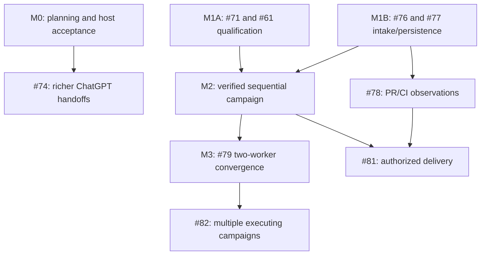

# Luna Factory — Engineering Handoff

**Prepared 10 October 2026. Research and planning only.** This is a reviewable campaign specification, not authorization to launch workers, deploy, change authentication/tunnels, edit Claude's worktree, mutate protected claims, merge or release.

## Starting checkpoint

PR68 is merged at `bec70a58865a1602dba6514736ec5101ba21a48b`, final UI head `96c84332c94e21c6ac3af1590cb805993ac2ceda`. Remote main and issue status were rechecked at 20:50:45 UTC. The final UI build and 171 local tests passed (one optional skip); final-head and merge-commit hosted checks succeeded. Rust source is unchanged from `dd304ef7a9ff8835176963ab26b72a72c1528607`. Dakota deployment and authenticated host acceptance of PR68 remain unverified; the user-reported preview is still the PR66 planning-only canary. [PR68] [CI-rust] [CI-ui] [CI-linux] [CI-windows] [CI-main-luna] [CI-main-plugins]

All #69–#82 remain open and unassigned beneath #67. Claude retains the assigned UI responsibility. #61 already has bounded continuation from PR63; its remaining live qualification belongs with #71. The full investigation and evidence pack provide immutable donor/source traces behind this handoff. [I61] [I67] [PR63]

## Governing architecture

Retain one Rust/SQLite authority and the existing durable semantic Luna owner. Add a real qualification/policy gate to the existing effect path. Qualify one recoverable sequential local-candidate campaign before enabling two workers. Keep the owner responsible for engineering meaning and acceptance; runtime/adapters enforce scope, readiness, accounting, ownership, evidence binding and cessation. The UI is a projection. [L-control] [L-store] [L-lifecycle] [L-evidence]

Use a thin Campaign reference to the canonical plan and runs, not a second graph store. Planning remains immutable; explicit promotion creates a new executable run. Extend existing attempts instead of inventing new generations. Preserve original proof; append verification of the current candidate and, before parallelism, its combined result. Unknown effects retain their reservations and claims. A stop acknowledgment is not verified cessation. [L-graph] [L-control] [P-evidence]

The highest-risk implementation seams are the actual qualification gate, per-attempt proof/settlement migration, provider containment/cancellation and logical external-effect recovery. They need strong architectural review before bounded workers can implement isolated slices. Projection, parser, fixture and documentation work can proceed inexpensively once those contracts are fixed.

## 1. Reconcile the existing engineering graph

**No new issue is necessary for the recommended campaign.** All changes below are proposals to the existing issue bodies and acceptance gates. Nothing was posted or reassigned. The latest read returned #61, #67 and all fourteen children #69–#82 open and unassigned; PR68 is merged. Claude remains the designated Mission Control engineer. Other engineering roles below are proposed assignments, not existing assignees or authorized workers. [I61] [I67] [PR68]

### 1.1 Issue-by-issue handoff

| Existing owner | Reconciliation and smallest useful slice | Regression evidence / gate | Parallelization boundary |
| --- | --- | --- | --- |
| **#61 — continuation** | Move the PR63 completion note above the historical problem statement. Retain the implemented live-owner `next`/`repair` path. Keep open for the real subscription/native owner, worker and cessation criterion; link that gate to #71. | Existing Factory continuation fixtures plus one exact-provider sequential acceptance and cancellation run. No restart replay of a saved directive. [I61] [L-continuation-tests] | Qualification engineer and Rust maintainer; no second pump or independent owner service. |
| **#67 / PR68 — Mission Control** | Record source integration and final-head/merge CI as complete. Keep authenticated preview acceptance distinct. Follow the chosen Map/Lanes, dispatch narrative, lunar branding and ChatGPT direction. | Build and local UI tests already pass; exact deployed build and authenticated host cases remain. [I67] [PR68] [U-live] | Claude owns UI follow-ups. Rust contributors provide additive contracts, not a replacement design. |
| **#69 — receipts/projections** | Add nullable known thread/task/attempt attribution, `created_at`, human source metadata and canonical activity ordering. Prefer an event sequence/cursor over treating wall-clock timestamps as a total order; expose timestamps for display. | Output schema, `mcp_contract`, graph e2e and UI parsing; unknown attribution stays null; source display never supplies proof. Preserve receipt/event retention bounds. [I69] [L-store] | One Rust projection/schema writer; Claude consumes the agreed contract. Avoid simultaneous competing edits to schemas. |
| **#70 — blockers** | Ship the requested typed presentation categories using existing reason/control facts. No lifecycle change is necessary for the first slice. Keep `needs` restricted to real decisions/approvals. | Each category and unknown fallback; classification cannot create a decision. If admitted-task blocked transitions are later added, preserve the required obligation separately from rejected unadmitted candidates. [I70] [L-control] | Can share the #69 contract PR if reviewed together; UI copy can proceed from fixtures. |
| **#71 — execution qualification** | Extend the acceptance from UI eligibility to a persisted exact-profile qualification checked by every effect path. First qualify one fixed Luna model, one active execution slot, original ceilings, real callback ownership, independent native verification and cessation. CAS execution stays separate. | Zero-send negative tests through public MCP and production Factory; no direct `Factory::start` bypass; real subscription inference with no API fallback; source, stop, claim and crash-window evidence. [I71] [L-lifecycle] | Requires strong architectural review. Keep qualification fixtures/adapters separate from #76's GitHub work; one maintainer integrates core state changes. |
| **#72 — assets** | Complete the moonlight logo/asset consistency task. PR68 already supplies the selected visual identity; this is asset cleanup, not design discovery. | Asset references, packaging and contrast at supported sizes. [I72] [PR68] | Small bounded UI task after Claude's source checkpoint; low priority relative to host acceptance. |
| **#73 — clear target note** | Use the permitted narrow UI option: suppress the invalid “No preference” submission while a target is set. Add a real clear operation only if clearing is an immediate product requirement. | Controller never submits `target_id: ""`; server no-op rejection stays intact. [I73] | Independent small UI follow-up, coordinated with Claude. No new execution target support. |
| **#74 — ChatGPT handoffs** | Treat PR68 prerequisite as complete. Keep #69 dependency for attributed context/mentions; composer draft and read-only view navigation can proceed independently where contracts permit. Verify the exact desktop/mobile/host messaging capability. | No automatic send on mount/connect, desktop draft where supported, explicit mobile action, read-only view tools, context labels, authenticated acceptance after an approved preview. [I74] | Claude owns implementation. Host testing must not enable execution or require #79. |
| **#75 — CAS timeline** | Implement bounded passive turn/item/snapshot reads for known owned identities first. Correct the assumption that `thread/timeline/list` and background-terminal methods are available on every native version. Agent-tree links are observations with provenance. | Exact CAS/native capability fixture, cursor/request/byte bounds, redaction and proof that reads never mutate criteria, claims or attempts. [I75] [A06] [A07] | Optional observer task after contract freeze. A non-loopback target requires a separately approved transport decision; no tunnel changes in this campaign. |
| **#76 — GitHub intake** | Retain the hybrid design: connector for conversation, least-privileged GitHub App for durable reads. Separate forge repository/issue IDs from the current physical common-dir identity. Read native sub-issues/dependencies and clearly mark parsed task-list or prose candidates. | Pagination/incomplete snapshots, cross-repository rejection, cycles, deletions, changed revisions, duplicate-source replay, no credential exposure. An absent `blocked_by` record does not erase a documented dependency. [I76] [L-repositories] | Bounded fixture/parser work can run alongside #71 after the identity contract is agreed with #77. App installation remains an operator step. |
| **#77 — campaign persistence** | Store a thin campaign reference to the canonical graph and run IDs, plus acceptance/policy references. Source-only planning metadata can ship before execution qualification. Promotion creates a new executable run from an exact approved revision; never flips the original run's planning flag. | Restart, stale/conflicting promotion, duplicate replay, source binding and planning-only zero dispatch. A draft plan revision cannot erase an admitted obligation. [I77] [L-graph] | Agree forge/physical identity once with #76. #69 is a presentation dependency; #71 gates promotion, not reading or saving a campaign. |
| **#78 — PR/CI telemetry** | Keep GitHub observations explicitly separate from proven criteria. Add retained source/head, producer/policy, observation time and bounded poll state before any autonomous delivery. Adapt Review's observer/backoff algorithms. | Wrong head/app/context, incomplete policy/pagination, stale data, rate-limit/restart bounds; reported success never certifies a criterion by itself. [I78] [P-github] | Parallel with sequential execution qualification after #76; not a prerequisite for a verified local candidate. |
| **#79 — parallel dispatch** | Split its broad scope into per-attempt ownership/proof migration, reservations/isolation and then two-worker scheduling. Add result subject, per-attempt cessation and aggregate candidate verification; existing generations stay. “Unchanged controls” must mean equivalent protected invariants through an explicit migration. | A stopped candidate can be checked while a peer runs without a false global-stopped claim; overlap/unknown reservations block; individually passing changes with a failing combination cannot converge. [I79] [L-evidence] | Strong Rust architecture lead first; independent fixtures after interfaces stabilize. Do not remove the single-active-attempt guard as a first PR. |
| **#80 — routing/escalation** | Extend the existing policy snapshot with exact allowed models and a persisted, bounded escalation reason/budget. Adapt Review's one-request-per-attempt advisor contract. A fixed qualified Luna route need not wait for general escalation. | Actual observed route/effort, out-of-policy reroute stop, no catalog-based Sol/Astra treatment, budget retained across retries and restart. [I80] [D-native] | Follows #71; can be separate from #79 if kept sequential. No new provider scheduler. |
| **#81 — authorized integration** | Preserve “Open PRs for review” as the eventual default and explicit merge authority. Add the missing staged push/PR effect certification before merge, using current-candidate proof and logical effect IDs. **Remove #79 as a hard prerequisite** for a sequential integration path; keep #71/#76/#78 and verified candidate proof. | Exact target/head/protection/required-policy checks, original proof retained, lost push/PR/merge acknowledgment reconciliation, no write in read-only recovery. [I81] [P-service] [P-github] | Strong effect-boundary review; operator grants concrete target/method/scope later. Parallelism provides no extra authority. |
| **#82 — multiple campaigns** | Defer execution concurrency across campaigns. Listing several source-only plans is safe earlier; multiple writers require a distinct qualification after one-campaign concurrency. | Forge-level and physical identity, shared resources/lockfiles/CI, overlapping and nonoverlapping campaigns, independent claim release. [I82] | Do not combine with the first #79 implementation. |

### 1.2 Dependency corrections and missing acceptance ownership

The prose requirements form no demonstrated cycle, but they hide several avoidable blocking edges. #79 still depends on the residual #61 live gate as well as #71; those should be one linked qualification checkpoint, not two implementations. #77 can persist and display plans without qualified execution; only promotion requires #71. #74's entire UI surface does not need to wait for receipt attribution. #81 can integrate a verified sequential result without #79. These are dependency corrections to propose, not changes already applied. [I61] [I74] [I77] [I79] [I81]

Three important requirements should be made explicit under existing owners. **Acceptance-contract identity** belongs with #77's campaign references; **the independent native check/acceptance path** belongs in #71's qualification gate and its normal Rust evidence path; **per-attempt and combined-candidate proof** belongs in #79. The one-slot governor belongs at #71's first dispatch gate and expands under #79; #80 adds policy-permitted model choices to that same governor. #78 supplies forge facts and #81 evaluates/adopts those facts for a specifically authorized delivery predicate. This avoids unowned convergence work without creating a new “governor project.”

## 2. Dependency-aware engineering campaign

The sequence below is a proposal for later authorization. A milestone closes on its acceptance evidence, not on the number of workers or merged PRs. Use small PRs with a single integration owner for Rust state/contracts. Bounded Luna workers are suitable for deterministic fixtures, projections, parser cases and documentation after the invariant is fixed. Provider qualification, proof migration and unknown-effect handling need a stronger architectural pass and independent review; model names alone do not make a review authoritative.

### M0 — Finish the usable planning surface

**Source integration is complete:** PR68 is merged and its final head and merge commit have successful hosted checks. Next, land #69/#70's additive projections, #73's narrow defect fix, and the independent read-only pieces of #74. #72 is small and nonblocking. Preserve the Campaign Map as primary and synchronized Flight Recorder/Lanes as secondary; use only observed identities and routing. [PR68] [I69] [I70] [I73] [I74]

**Engineering owner:** Claude for UI; one designated Rust maintainer for projections/schema. **PR boundaries:** one additive contracts PR, one UI adoption/handoff PR, optional small asset/defect follow-up. **Integration checkpoint:** current graph, receipt bounds, stale/unknown states and read-only navigation work against the actual server. **Operator gate:** deploy the exact reviewed build to the isolated preview and perform authenticated host acceptance only after explicit authorization. Source/CI success cannot authorize that deployment.

### M1 — Two independent foundation lanes

**M1A: #71 + residual #61.** Add persisted qualification and an effect-path gate; retain one active execution slot and a fixed qualified Luna route. Record authority, exact version/ownership profile, callback behavior, source, original deadline/budgets, independent checker behavior and cessation. Start with the smallest owned native mode that can be qualified. Preserve passive recovery when execution becomes ineligible. No raw provider path may bypass this gate. [I71] [I61]

Bootstrap this without a circular permission rule: #71 must define an operator-authorized, bounded qualification harness/canary in a disposable workspace. Its qualification-only grant names the exact candidate profile, operations and limits, is retained by the same authority, and cannot authorize ordinary campaigns. Ordinary `execution.eligible` remains false until the required profile/operation evidence is recorded. Do not use the current ungated direct-start path as an undocumented testing exception. M1 qualifies provider/profile operations; M2 qualifies the complete engineering convergence path.

**M1B: #76 + #77.** Agree forge/physical repository identity and a thin campaign/plan/promotion contract, then implement bounded fixture-backed GitHub intake and durable source-only planning. A user can inspect an issue graph without configuring Codex execution. Promote by creating a new run only when M1A and explicit authority permit it. [I76] [I77]

**Parallelism:** these lanes can run concurrently after one short shared identity/API review. One changes qualification/native lifecycle; the other changes intake and campaign metadata. Serialize competing edits to Store/Control/schema through the integration maintainer. GitHub fixture parsing and UI read projections can use inexpensive bounded workers. Native containment/auth/callback design requires stronger reasoning and live operator participation later.

**PR boundaries:** qualification record plus zero-send effect gate; native profile and failure fixtures; forge snapshot/identity contract; campaign metadata and exact-revision promotion. Avoid putting all four into one large PR. Native credential changes, a GitHub App installation and live canary execution remain operator gates, not tasks an unattended coding worker can infer.

### M2 — Prove a useful sequential engineering campaign

The first end-to-end gate is **one issue objective → durable plan → explicitly admitted run → bounded ordinary continuation → independently verified local candidate**. Include a current failed attempt/repair and a real stop/restart case. Keep the original deadline and attempt/repair ceilings. Use the normal evidence pipeline; no fixture may substitute a successful `validateProof`. Record a meaningful acceptance contract and keep semantic acceptance with the durable Luna owner. [L-continuation-tests] [L-evidence] [P-tests]

The initial verification ceiling is `local_candidate`, because current push/PR delivery is deliberately uncertified. This stages the intended “Open PRs for review” product default; it does not replace that established direction. In parallel, #78 can supply read-only PR/CI observations once #76 exists. General escalation (#80), CAS timelines (#75), merge authority (#81) and parallelism (#79) are not prerequisites for the local-candidate gate. [L-control] [I78] [I81]

**Engineering owner:** Rust maintainer plus a separate qualification reviewer. **PR boundary:** captured predicates/check results and normal-path sequential verification. **Exit evidence:** two necessary tasks continue with zero routine external resume calls, source/assumption movement invalidates evidence, a failed check cannot be narrated away, uncertainty retains claims, cancellation proves the supported execution scope, and the UI presents the same state honestly. Only then describe the end-to-end engineering campaign path as qualified. M1's operation-level provider qualification remains a separate, narrower evidence record.

### M3 — Make two-worker execution independently safe

Keep one campaign mutation claim per logical repository. First migrate global proof/settlement prerequisites into per-attempt candidate validation plus a final campaign barrier while still dispatching one attempt. Then add transactionally reserved worker capacity, explicit workspace ownership and conservative overlap rules. Finally admit two independent workers. Each has its own handle, immutable input and result, qualification, reservation and cessation evidence. The semantic owner remains the existing Luna owner; it submits admitted proposals and interprets results. [I79] [L-control] [L-evidence]

Use separate **worker-slot** and **total active model-call** ceilings so owner, verifier and escalation calls are counted without confusing them with idle threads. A two-worker profile can leave the owner idle while both slots are occupied; it must never get a free unaccounted third model call. Unknown and cancelling reservations remain occupied.

**PR boundaries:** serial proof/ownership migration; workspace/reservation/cancellation contract; combined-candidate construction/verification exercised serially or through fixtures; finally enable the two-worker scheduler only after aggregate-proof and cessation gates pass. Each must retain serial regression behavior. No intermediate release may enable concurrency against incomplete proof semantics. **Parallel work:** fixture authors can cover crash, overlap and mixed-success scenarios once the contracts are fixed; they must not independently change the reducer. **Exit evidence:** individually passing candidates whose combination fails stay unconverged; one worker's stop cannot kill its owner/peer; no duplicate launch or premature workspace reuse occurs after a crash.

### M4 — Add only the integrations that are now useful

- **#75** can enrich Lanes independently when the exact read-only CAS operations and transport are approved. It does not need or enable CAS execution.
- **#80** can add one bounded, qualified Sol/Astra escalation to a sequential or parallel campaign. Persist its reason, route and original budget; it is not permission for arbitrary model changes.
- **#81** can follow M2 plus #78, even before M3, when delivery is more valuable than throughput. Stage certified push/open-PR effects before merge; grant integration only for a concrete target and method. This is the main evidence-driven reorder from the provisional roadmap.
- **#82** waits until M3 demonstrates independent worker ownership and aggregate proof. Source-only multi-campaign navigation can precede executing multiple campaigns on one repository.
- **Cloud Tasks** stays ineligible for autonomous writes until the missing primitive contracts are available and qualified. A beta Agents API adapter is a separately authorized API-billed option, not a prerequisite or substitute entitlement.

These tasks are alternative next priorities after the foundation, not an instruction to launch all of them together. The best next choice depends on which accepted campaign is blocked: visibility (#75), reasoning (#80), delivery (#81), or throughput (#79/#82).

### Proposed dependency view

The UI can continue shipping independently of provider qualification. #75 and #80 are optional branches omitted from the diagram to keep the critical dependencies visible. Cloud support is contingent on provider contracts rather than on completing another local feature.

## 3. Acceptance and verification strategy

**Qualify one recoverable sequential campaign before admitting parallel work.** The gates below are proposed for a later authorized engineering campaign. Each acceptance record should name the source commit, binary/image digest, provider and native version, account authorization route, ownership/containment profile, database migration, policy and acceptance-contract revisions, exercised operations, results and remaining unknowns. Store references and bounded evidence, never credentials. A passed mock-provider test, hosted CI job and authenticated runtime exercise are different evidence classes. [L-adoption] [I71]

### What has actually been verified

This research ran the final PR68 UI build and local tests: 171 passed, one optional test skipped. Exact-head Rust/UI/Linux/Windows hosted checks were observed; local Rust and Go tests were not run because those toolchains were unavailable. Review local runs produced 168/171 default passes, 178/180 PR353 core/batch passes and 11/11 convergence passes. Its process-owner recovery tests and default sandbox-preflight gate failed here. PR353's main repair fixture bypasses `validateProof`, so its passes are not production proof-path qualification. No live native execution, hosted-PR repair, deployment or authenticated ChatGPT acceptance was performed during this investigation. Existing PR63 Factory tests establish controlled continuation behavior, with live qualification still tracked separately. [CI-rust] [CI-ui] [CI-linux] [CI-windows] [P-tests] [L-continuation-tests] [I61]

### Gate 1: admission reaches every effect boundary — #61, #71, #76, #77

Drive negative cases through public MCP operations and the production Factory/SQLite path while a recording transport counts actual outgoing requests. Missing, stale, revoked or mismatched qualification must produce **zero execution sends** for start, continuation, repair and integration. Repeat with stale revision, changed source, foreign claim, exhausted budget, denied model, widened finish authority and an unknown effect. Revoke authorization while an adapter awaits readiness; the final pre-wire guard must refuse the send. UI Start eligibility alone cannot satisfy this gate. Before ordinary qualification exists, only an explicitly authorized, retained qualification-only grant may run the bounded test harness; test that it cannot dispatch an ordinary campaign or escape its named operations/limits. Keep qualified observation and authorized containment available when new execution is denied. [L-lifecycle] [L-store] [I71]

Test raw bypasses on the chosen runtime profile: unapproved native/CAS mutation tools, direct provider calls, another agent launcher, protected configuration and credentials must not offer an alternate execution route. A prompt prohibition or a failing hook is insufficient. Record whether the boundary actually prevents the operation or lacks the capability; unsupported profiles remain ineligible. Apply the same rule to owner, worker, model-verifier and escalation turns. [L-backends] [N01] [N02] [N07]

For #76/#77, bind imported source to stable forge identity and an exact planning revision. Truncated or unavailable dependency reads remain incomplete; inferred visual edges do not become admission prerequisites without explicit canonical graph admission. Promotion creates one new executable run idempotently; editing a planning-only flag, reopening its view or refreshing GitHub cannot execute it. Test conflicting promotion fingerprints and cross-workspace references. [L-graph] [L-control] [U-contract]

### Gate 2: crash windows preserve uncertainty — #61, #71, later #81

Use deterministic transport faults plus process restarts around these boundaries:

| Crash or fault | Required result after restart |
| --- | --- |
| Intent persisted, send not yet performed | Reconcile the retained operation; retry only with authoritative no-send evidence. |
| Remote accepted, acknowledgment lost | UNKNOWN retains its reservation and scope; no fresh key or duplicate send. |
| Acknowledgment received, settlement not persisted | Recover the original owned result; do not repeat the operation. |
| Settlement persisted, claim release interrupted | Idempotent cleanup preserves settled history and never releases another owner's claim. |

Assert durable rows, logical operation IDs, transport send counts and retained acknowledgments. Same key plus changed payload must conflict. A negative lookup or disappeared thread does not prove a delayed effect cannot occur. Native dispatch correlation is not a server-side deduplication guarantee. For an unacknowledged thread creation, absence of a recoverable owned ID must remain explicit; matching cwd is not adoption authority. [L-store] [L-native] [N15] [H-executor] [H-replay]

### Gate 3: independent proof on immutable candidates — sequential first, then #79

Exercise the unmodified production verification path. Capture permitted predicate specifications before execution; run or obtain the checks independently against a frozen candidate and recorded environment. A worker's “tests passed” file with a valid hash must fail to establish that the prescribed command ran. Zero exit with incomplete output, wrong environment, stale assumptions or mismatched task/attempt/dispatch/subject must remain unproved. Keep the owner's semantic acceptance as a separately bound judgment. Tests must not replace proof validation with a no-op or write a success state directly. [L-evidence] [P-evidence] [P-tests]

Mutate candidate bytes, base, dependencies, policy or acceptance revision between check execution, acceptance and final persistence. Each movement must invalidate current proof or prevent settlement. Preserve original worker receipts; append verification of the actual integration candidate. Repeat after restart to prove decoding cannot upgrade legacy or stale receipts. PR353 supplies this provenance principle for one integrated attempt; aggregate assembly is new target work. [P-service] [P-evidence]

The sequential acceptance case should import a bounded issue objective, promote its exact plan, complete two necessary tasks through existing guarded continuation, retain a failed attempt and bounded repair, independently verify the final local candidate and converge without another operator prompt for routine admitted work. A real operator decision must stop continuation. No delivery beyond the admitted local-candidate ceiling is needed for this milestone. [L-continuation] [L-continuation-tests] [I61]

### Gate 4: one recoverable authority and truthful cessation — #61, #71

Start a second daemon against the same database: it must refuse writer ownership. Kill the sole daemon while a separately owned worker process remains alive, then restart the authority. It must recover existing owner/attempt identities, absolute deadlines, effects and claims through passive observations without replaying a saved continuation directive or starting another semantic owner. An inherited workspace fence may block reuse while permitting the authority itself to reopen. A stale process identity must not authorize killing or adopting an unrelated process. [L-store] [L-lifecycle] [V-fence]

Cancel during startup, ordinary command execution, verification and acknowledgment loss. Persist cancellation before interrupts. Observe ordinary subprocesses separately from agent descendants; include a late child, failed enumeration, dropped stop acknowledgment and vanished terminal. Claims and slots remain held until required cessation and effect settlement are proved. QUIESCENT is not stopped evidence. [L-lifecycle] [L-native] [L-adoption]

A shared native daemon's threads are not independent process groups: demonstrate per-thread cessation without killing owner or peers, or leave that profile unsupported. For separately owned stdio processes/containers, test real process cleanup and retained fencing after parent death. Unix group tests do not qualify escaped processes, Windows or remote workers. Destruction of an owned process can prove cessation while earlier external effects remain UNKNOWN. [V-fence] [V-pgroup-tests]

### Gate 5: budgets and two-worker integration — #79, #80; #82 deferred

Carry original attempt, repair, escalation and wall-time limits across restarts, model changes and replacement processes. Exhaust them during a wait and during an in-flight operation: new admission must stop, bounded shutdown must be requested, and uncertain termination must retain reservations. Include active owner, worker, model-verifier and escalation calls. Delayed or absent usage accounting must suppress hard token/dollar claims. Test a permitted exact-model escalation and an out-of-policy reroute; only verified observed routing can enable its UI treatment. [L-continuation] [L-lifecycle] [Q-policy] [I80]

Only after per-attempt identity, settlement and candidate-proof migration should #79 admit two workers. Assert separate handles/workspaces, current prerequisites, transactional resource reservations, at most two occupied worker slots within the separately enforced total model-call ceiling, and no third worker dispatch when one slot is UNKNOWN. Reject overlapping or unknown write resources before either conflicting operation starts. Keep one campaign repository claim; do not include #82's multiple-writer scope. [L-control] [L-evidence] [I79]

Use a fixture where each isolated candidate passes but their combination fails. Aggregate verification must bind the member task/attempt receipts, original bases, assembly operation and immutable combined subject; no campaign convergence follows until that combined result passes and required execution ceases. Test one worker cancelling while another completes, stale dependency proof and an admitted required obligation becoming blocked. Current Blocked records represent rejected unadmitted candidates; preserve their non-obligation semantics when adding new blocker transitions. [L-control] [L-adoption] [P-service]

### Gate 6: forge effects and truthful host acceptance — #69, #70, #78, #81

#78 must retain bounded, timestamped GitHub observations without converting check success, issue closure or a PR URL into criterion proof. Test wrong head/merge subject, changed required-check policy or producer, incomplete pagination, Retry-After across restart and stop during the final read. Read-only reconciliation must never create a PR or authorize repair. Under separately granted #81 authority, test exact target/protection checks and lost push/PR/merge acknowledgments through the same effect journal. Parallel dispatch is not technically required for sequential integration; changing #81's current #79 dependency remains a proposed issue correction. [P-github] [P-service] [I78] [I81]

For #69/#70, test event ordering, cursor bounds, reconnects, stale evidence and absent attribution. Render a worker only from an actual bound identity; distinguish waiting, UNKNOWN, cancelling and verified stopped. Only answerable decisions enter Needs you. A stale UI action must be rejected by the same production gate as direct MCP. [L-lifecycle] [U-contract]

Finally, after explicit deployment approval, bind authenticated ChatGPT acceptance to the exact preview build and endpoint. Exercise real view mounting, planning selection, blocker/evidence display, reconnect and allowed read actions, preserving the planning canary and unrelated retained claims. Record separately which execution controls become available only after #71. Browser fixtures, successful builds and captures do not establish authenticated host acceptance or native execution. [U-live] [U-contract] [I71]

## 4. Decision memo

The investigation is complete without any approval or execution action. The decisions below govern a **later** engineering campaign. They are concrete recommendations with alternatives; none has been applied to services, credentials, issues or execution providers.

### Decisions already established by the mission

Retain one Rust/SQLite authority, the existing durable semantic Luna owner, the selected Campaign Map/Lanes direction and ChatGPT conversational control. Preserve immutable scope, claims, revision/replay fences, valid evidence and verified cessation. Do not import Hive, OMP or Review as an extra runtime dependency. Do not add a workbench governor or a second truth store. The donor implementations support strengthening the existing boundary rather than replacing it. [L-adoption] [L-store] [D-index] [H-main-boundary]

### Choices for the next authorized campaign

| Decision | Recommended choice | Alternative and tradeoff | Approval or evidence needed before action |
| --- | --- | --- | --- |
| **Initial execution and ownership profile** | Qualify an owned local native profile first, one active execution slot and fixed Luna routing. For later managed workers, prefer separately owned stdio processes/containers while retaining the same semantic owner. | Shared native-daemon threads reduce process overhead but require proven per-thread/terminal cessation and cannot be treated as independent process groups. Owner-native children require a genuine pre-spawn gate. | Choose the supported platform/profile for #71; then prove entitlement, callbacks, resource isolation, no unregistered execution, crash recovery and cessation on that exact build. [I71] [D10] [N05] |
| **Verification and acceptance contract** | Capture versioned predicates before worker mutation; execute/observe checks independently; record immutable current-candidate facts; let the durable owner make semantic acceptance. | A fresh model can review meaning, at additional cost, but model diversity alone supplies no independent authority. Worker-authored logs alone are insufficient. A full principal/grant framework is unnecessary for the first local scope. | Approve which check definitions are load-bearing, who may revise them, permitted verifier execution and how missing/contradictory evidence blocks completion. [L-evidence] [P-evidence] [I-4257] |
| **Ordinary-user distribution** | Support inspection without execution setup; pursue a user-owned local companion with legitimate subscription-native sign-in, and eligible OSS SIWC only where its documented terms/profile apply. Dakota remains an advanced test environment. | A user-owned VM adds always-on compute/operations. A general hosted subscription-token service requires an independently supported authorization route. An API-backed service changes billing and operations. | Verify the actual ChatGPT account/install channel, compute and execution entitlement separately. Do not promise Plus write-MCP support or free hosted execution before acceptance. [D07] [D09] [D18] |
| **First completion ceiling and delivery order** | First qualify a local candidate. Preserve the established product default of opening PRs for review once push/PR effects are certified. Let sequential authorized integration precede parallel dispatch if delivery is the practical blocker. | Prioritizing #79 first improves throughput but does not solve delivery effects. Automatic merge adds protected-branch/policy/unknown-ack handling and requires separate authority. | Reconcile #81's dependency and stage its effects; any later integration approval must name target branch, method, exact scope and repository ceiling. [I81] [L-control] [P-github] |
| **Governor defaults and escalation** | Start with one active call, then two worker reservations under a separate total-call ceiling. Preserve original wall/attempt/repair limits; allow at most one policy-approved escalation request per attempt when #80 is qualified. Unknown work retains capacity. | Larger fan-out or autonomous escalation increases resource and recovery uncertainty. Hard cost limits are impossible to promise without an authoritative accounting/enforcement source. | Operator chooses original campaign ceilings and exact allowed models; qualification records the accounting limits. No silent API fallback, no counter reset through replan/restart. [I79] [I80] [D-native] |
| **Cloud provider priority** | Keep the provider seam and truthful capability explanation; defer automatic Cloud writer admission. | A separately qualified beta Agents API provider has documented session operations but API/model/compute charges and distinct identity/recovery requirements. | Only pursue it when an operator explicitly selects that billing/provider route, or when Cloud supplies the missing source, acknowledgment-recovery and stop contracts. [C03] [C04] [D20] [D21] |
| **Preview deployment and host acceptance** | Treat PR68 as merged and tested source; prepare an exact build/digest and rollback plan for a later isolated preview deployment. Preserve canary and unrelated held claims. | Deferring deployment permits more fixture work but cannot establish authenticated ChatGPT behavior. Deploying alone cannot qualify native execution. | Explicit later deployment authorization, then recorded authenticated read-only host acceptance. No service or tunnel change was made by this investigation. [PR68] [I67] [I74] |

### What to leave behind deliberately

Leave behind the broad Hive fleet/dashboard/messaging architecture, its unmanaged-work admission fallback for enrolled campaigns, default shadow as a substitute for enforced authority, and any fail-open persistence or boundary initialization. Do not import its several JSON stores or assume staged objective-proof packages are an end-to-end convergence engine. Carry over the specific enforcement algorithms and adversarial cases instead. [H-config] [H-deps] [H-main-boundary] [H-outcome-ledger] [H-verify]

Leave behind OMP session/extension/global-symbol machinery, the Review appliance, unsupported native-control tool shims and a second batch journal. Reuse constrained execution, original-proof preservation, fresh committed-head verification, bounded hosted-check polling and same-PR repair invariants through Luna's existing adapter/store. Do not mistake PR353's test override or a policy-hook probe for live qualification. [D-bridge] [D-index] [D-store] [P-tests] [Q-policy]

Leave behind the old Changeplane runtime and broad ontology, private Cloud API assumptions, catalog-based execution eligibility, a UI-derived scheduler, unaccounted native descendants and completion-by-exit-code. They do not supply the minimal trustworthy product. Current Luna already has stronger replay, graph and evidence protections than the historical prototype. [CP-engine] [CP-reconcile] [L-control] [L-evidence] [N15]

### The five answers

**What is already valuable?** The Rust control kernel and its tests; durable owner and claim identity; exact admission/replay fences; current task-bound evidence; conservative unknown-effect/cessation handling; PR63 continuation; and the now-merged Mission Control experience. In the donors, valuable execution algorithms exist, but their qualification is narrower than the system names suggest.

**What materially improves Luna?** Hive's enforce-mode logical-effect/epoch/replay invariants and v6 execution-owned settlement/workspace fences; Review's constrained checker/acceptance boundary and PR353's immutable original/current-result provenance and bounded PR observation/repair; operation-specific provider contracts with durable recovery identities.

**What stays out?** Another Hive, another owner service, OMP as a dependency, another governor/store, broad Changeplane semantics, parallelism without candidate-proof migration, and unsupported Cloud write paths.

**What is the minimum architecture?** One existing Rust/SQLite authority, one durable semantic Luna owner, a real gate on every effect, qualified execution ownership, bounded reservations and repair budgets, captured check contracts, immutable attempt-bound current-candidate evidence, combined-candidate evidence before parallel workers, conservative recovery/cancellation, and truthful projections to ChatGPT.

**What is the implementation order?** Close the UI/host gap and additive contracts; in parallel qualify one native profile and build source-bound intake/campaign persistence; prove a useful sequential local candidate; then choose qualified delivery or two-worker convergence based on the accepted campaign's need. Add optional observation/escalation later, multi-campaign writers last, and Cloud only when its actual provider contract supports the required guarantees.

[A06]: https://github.com/joshyorko/codex-action-server/blob/75acbaac83095f2dd49c2e1d432e4f553f7c0c7f/src/native_capabilities.py#L325-L350
[A07]: https://github.com/joshyorko/codex-action-server/blob/75acbaac83095f2dd49c2e1d432e4f553f7c0c7f/src/codex_shared/threads.py#L326-L639
[C03]: https://github.com/openai/codex/blob/de8fab6d7adfcef8b4ce6f02f3b5c8be4092015a/codex-rs/cloud-tasks-client/src/api.rs#L25-L176
[C04]: https://github.com/openai/codex/blob/de8fab6d7adfcef8b4ce6f02f3b5c8be4092015a/codex-rs/cloud-tasks-client/src/http.rs#L332-L394
[CI-linux]: https://github.com/joshyorko/plugins/actions/runs/38083347337/job/114304622274
[CI-main-luna]: https://github.com/joshyorko/plugins/actions/runs/38083959154
[CI-main-plugins]: https://github.com/joshyorko/plugins/actions/runs/38083959178
[CI-rust]: https://github.com/joshyorko/plugins/actions/runs/38083347277/job/114304621864
[CI-ui]: https://github.com/joshyorko/plugins/actions/runs/38083347277/job/114304621672
[CI-windows]: https://github.com/joshyorko/plugins/actions/runs/38083347337/job/114304622492
[CP-engine]: https://github.com/joshyorko/plugins/blob/6e0d19f1298a1f8b7963bd3cea8989e8274bc9e6/plugins/changeplane/core/changeplane/engine.py
[CP-reconcile]: https://github.com/joshyorko/plugins/blob/6e0d19f1298a1f8b7963bd3cea8989e8274bc9e6/plugins/changeplane/core/changeplane/reconcile.py
[D-bridge]: https://github.com/joshyorko/review/blob/4305efce0c156dc4224dd95db8e493be5f1abee5/image/extension/luna-factory/omp/batch-bridge.ts
[D-index]: https://github.com/joshyorko/review/blob/4305efce0c156dc4224dd95db8e493be5f1abee5/image/extension/luna-factory/index.ts
[D-native]: https://github.com/joshyorko/review/blob/4305efce0c156dc4224dd95db8e493be5f1abee5/image/extension/luna-factory/omp/batch-native.ts
[D-store]: https://github.com/joshyorko/review/blob/4305efce0c156dc4224dd95db8e493be5f1abee5/image/extension/luna-factory/omp/batch-store.ts
[D07]: https://developers.openai.com/siwc/token-sharing-open-source
[D09]: https://developers.openai.com/siwc/token-sharing-open-source/self-hosted-vms
[D10]: https://learn.chatgpt.com/docs/app-server
[D18]: https://help.openai.com/en/articles/12584461-developer-mode-and-mcp-apps-in-chatgpt
[D20]: https://developers.openai.com/api/docs/guides/agents-api/sessions
[D21]: https://developers.openai.com/api/docs/guides/agents-api/environments/openai-hosted
[H-config]: https://github.com/hivecommons/hive/blob/38195751be0966d59163280e765352f4e479f0fd/src/pkg/config/convergence.go
[H-deps]: https://github.com/hivecommons/hive/blob/38195751be0966d59163280e765352f4e479f0fd/src/pkg/dashboard/contribute_admission_deps.go
[H-executor]: https://github.com/hivecommons/hive/blob/38195751be0966d59163280e765352f4e479f0fd/src/pkg/convergence/mutation/executor.go
[H-main-boundary]: https://github.com/hivecommons/hive/blob/38195751be0966d59163280e765352f4e479f0fd/src/cmd/hive/main.go#L1990
[H-outcome-ledger]: https://github.com/hivecommons/hive/blob/38195751be0966d59163280e765352f4e479f0fd/src/pkg/convergence/outcome/ledger.go
[H-replay]: https://github.com/hivecommons/hive/blob/38195751be0966d59163280e765352f4e479f0fd/src/pkg/convergence/mutation/replay_result_test.go
[H-verify]: https://github.com/hivecommons/hive/blob/38195751be0966d59163280e765352f4e479f0fd/src/pkg/convergence/proof/verify.go
[I-4257]: https://github.com/hivecommons/hive/issues/4257#issuecomment-5362993543
[I61]: https://github.com/joshyorko/plugins/issues/61
[I67]: https://github.com/joshyorko/plugins/issues/67
[I69]: https://github.com/joshyorko/plugins/issues/69
[I70]: https://github.com/joshyorko/plugins/issues/70
[I71]: https://github.com/joshyorko/plugins/issues/71
[I72]: https://github.com/joshyorko/plugins/issues/72
[I73]: https://github.com/joshyorko/plugins/issues/73
[I74]: https://github.com/joshyorko/plugins/issues/74
[I75]: https://github.com/joshyorko/plugins/issues/75
[I76]: https://github.com/joshyorko/plugins/issues/76
[I77]: https://github.com/joshyorko/plugins/issues/77
[I78]: https://github.com/joshyorko/plugins/issues/78
[I79]: https://github.com/joshyorko/plugins/issues/79
[I80]: https://github.com/joshyorko/plugins/issues/80
[I81]: https://github.com/joshyorko/plugins/issues/81
[I82]: https://github.com/joshyorko/plugins/issues/82
[L-adoption]: https://github.com/joshyorko/plugins/blob/dd304ef7a9ff8835176963ab26b72a72c1528607/plugins/luna-factory/docs/control-adoption.md
[L-backends]: https://github.com/joshyorko/plugins/blob/dd304ef7a9ff8835176963ab26b72a72c1528607/plugins/luna-factory/server/src/backends.rs
[L-continuation]: https://github.com/joshyorko/plugins/blob/dd304ef7a9ff8835176963ab26b72a72c1528607/plugins/luna-factory/server/src/continuation.rs
[L-continuation-tests]: https://github.com/joshyorko/plugins/blob/dd304ef7a9ff8835176963ab26b72a72c1528607/plugins/luna-factory/server/tests/continuation.rs
[L-control]: https://github.com/joshyorko/plugins/blob/dd304ef7a9ff8835176963ab26b72a72c1528607/plugins/luna-factory/server/src/control.rs
[L-evidence]: https://github.com/joshyorko/plugins/blob/dd304ef7a9ff8835176963ab26b72a72c1528607/plugins/luna-factory/server/src/evidence.rs
[L-graph]: https://github.com/joshyorko/plugins/blob/dd304ef7a9ff8835176963ab26b72a72c1528607/plugins/luna-factory/server/src/graph.rs
[L-lifecycle]: https://github.com/joshyorko/plugins/blob/dd304ef7a9ff8835176963ab26b72a72c1528607/plugins/luna-factory/server/src/lifecycle.rs
[L-native]: https://github.com/joshyorko/plugins/blob/dd304ef7a9ff8835176963ab26b72a72c1528607/plugins/luna-factory/server/src/native.rs
[L-repositories]: https://github.com/joshyorko/plugins/blob/dd304ef7a9ff8835176963ab26b72a72c1528607/plugins/luna-factory/server/src/repositories.rs
[L-store]: https://github.com/joshyorko/plugins/blob/dd304ef7a9ff8835176963ab26b72a72c1528607/plugins/luna-factory/server/src/store.rs
[N01]: https://github.com/openai/codex/blob/de8fab6d7adfcef8b4ce6f02f3b5c8be4092015a/codex-rs/core/src/tools/registry.rs#L701-L754
[N02]: https://github.com/openai/codex/blob/de8fab6d7adfcef8b4ce6f02f3b5c8be4092015a/codex-rs/hooks/src/events/pre_tool_use.rs#L194-L327
[N05]: https://github.com/openai/codex/blob/de8fab6d7adfcef8b4ce6f02f3b5c8be4092015a/codex-rs/app-server-protocol/src/protocol/v2/thread.rs#L60-L166
[N07]: https://github.com/openai/codex/blob/de8fab6d7adfcef8b4ce6f02f3b5c8be4092015a/codex-rs/core/src/tools/handlers/multi_agents_tests.rs#L2485-L2536
[N15]: https://github.com/openai/codex/blob/de8fab6d7adfcef8b4ce6f02f3b5c8be4092015a/codex-rs/app-server/tests/suite/v2/turn_start.rs#L930-L995
[P-evidence]: https://github.com/joshyorko/review/blob/51094b041c975ac258bb2339d211fafb33e84776/image/extension/luna-factory/core/evidence.ts
[P-github]: https://github.com/joshyorko/review/blob/51094b041c975ac258bb2339d211fafb33e84776/image/extension/luna-factory/omp/batch-github.ts
[P-service]: https://github.com/joshyorko/review/blob/51094b041c975ac258bb2339d211fafb33e84776/image/extension/luna-factory/omp/batch-service.ts
[P-tests]: https://github.com/joshyorko/review/blob/51094b041c975ac258bb2339d211fafb33e84776/tests/luna_factory_batch.test.ts
[PR63]: https://github.com/joshyorko/plugins/pull/63
[PR68]: https://github.com/joshyorko/plugins/pull/68
[Q-policy]: https://github.com/joshyorko/review/blob/1150839faaf1a5170e60c529d55a63fa0962600b/docs/factory/omp-18-5-policy-hook-qualification.md
[U-contract]: https://github.com/joshyorko/plugins/blob/96c84332c94e21c6ac3af1590cb805993ac2ceda/plugins/luna-factory/docs/mission-control.md
[U-live]: https://github.com/joshyorko/plugins/blob/96c84332c94e21c6ac3af1590cb805993ac2ceda/plugins/luna-factory/ui/test/live-plan-capture.mjs
[V-fence]: https://github.com/hivecommons/hive/blob/5779820b1dc0edbd8ede2556e3e6b6c610a54fbe/src/pkg/dashboard/spek_hub_executor_fence_unix.go
[V-pgroup-tests]: https://github.com/hivecommons/hive/blob/5779820b1dc0edbd8ede2556e3e6b6c610a54fbe/src/pkg/dashboard/spek_hub_executor_pgroup_unix_test.go
